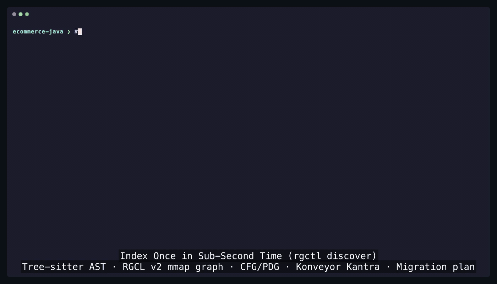

# rgctl - Code knowledge graph for LLM agents.

[](https://github.com/rgctl/rgctl/releases/latest)
[](https://github.com/rgctl/rgctl/releases)
[](https://github.com/rgctl/rgctl/stargazers)
[](LICENSE)

[](https://github.com/rgctl/rgctl/actions)
[](https://rgctl.io/)
[](https://rgctl.io/)
[](https://www.rust-lang.org/)
[](https://github.com/rgctl/rgctl/releases/latest)
[](https://tree-sitter.github.io/tree-sitter/)
[](https://rgctl.io/docs/guides/agent-skill/)
[](https://rgctl.io/docs/languages/)

[](https://rgctl.io/docs/languages/)
[](https://rgctl.io/docs/languages/)
[](https://rgctl.io/docs/languages/)
[](https://rgctl.io/docs/languages/)
[](https://rgctl.io/docs/languages/)
[](https://rgctl.io/docs/languages/)
[](https://rgctl.io/docs/languages/)
[](https://rgctl.io/docs/languages/)
[](https://rgctl.io/docs/languages/)
[](https://rgctl.io/docs/languages/)
[](https://rgctl.io/docs/languages/)
[](https://rgctl.io/docs/languages/)
[](https://rgctl.io/docs/languages/)
[](https://rgctl.io/docs/languages/)
[](https://rgctl.io/docs/languages/)
[](https://rgctl.io/docs/languages/)
[](https://rgctl.io/docs/languages/)
[](https://rgctl.io/docs/languages/)
[](https://rgctl.io/docs/languages/)
[](https://rgctl.io/docs/languages/)
[](https://rgctl.io/docs/languages/)
[](https://rgctl.io/docs/languages/)
[](https://rgctl.io/docs/languages/)
[](https://rgctl.io/docs/guides/markdown-context-graph/)

> Index once (`discover`), then ask callers, blast radius, control/data-flow slices, clones, communities, and PR call-path deltas — compact deterministic JSON for agents, not grepping the tree.

**What the R stands for:** **R**ust · **R**eachability · **R**ich graph (30+ typed relations, Hybrid CPG, mmap snapshots).

### Without `rgctl` vs with `rgctl`

| Dimension | Without (grep / dump files) | With `rgctl` |
|-----------|-----------------------------|--------------|
| **Tool calls for “who calls X transitively?”** | Many greps + ad-hoc file reads | 1–2 (`discover` once, then `callers` / `blast-radius`) |
| **Context tokens** | Whole files / search dumps into the prompt | Compact `-f json` payloads (`schema_version`) |
| **Transitive reachability & PR review** | Easy to miss or hallucinate | Precomputed SCC reachability, `blast-radius`, `review paths` |
| **Control & data flow** | Manual line-by-line tracing | Statement-level `slice`, `cpg flows`, `inspect` (lazy on-demand CFG / PDG / dominance) |
| **Error recovery for agents** | Raw exit codes or unstructured stderr | Structured JSON error envelope (`error_code`, `candidates`, `recovery_command`) |

### Battle-tested at scale

Cold discover (single-pass `KindDispatchTable` + `ScopeStack` AST engine) and zero-cold-touch mmap queries on real-world repositories (Apple M3 Pro, 36 GB RAM; see [AGENTS.md](AGENTS.md) Gate A/B and [profile notes](docs/internal/profile.md)):

- **Linux kernel** (72.4k files, 1.76M nodes, 6.35M edges): cold discover in **~48.1 s**
- **metasfresh** (11.1k Java files, 313k nodes, 1.03M edges): **~9.3 s** default (**~26.0 s** `--full` with CFG/CPG + Universe + harmonic)
- **rustc** (37.6k Rust files, 472k nodes, 1.73M edges): **~23.5 s**
- **Roslyn** (`src/` — 18.1k C# files, 358k nodes, 1.19M edges): **~15.3 s**
- **VS Code** (`src/` — 9.0k TS files, 522k nodes, 1.44M edges): **~12.7 s**
- **Home Assistant** (18.6k Python files, 582k nodes, 1.40M edges): **~11.8 s**
- **LLVM `clang/`** (11.2k C++ files, 190k nodes, 585k edges): **~10.4 s** · **Apache Kafka** (6.9k files, 236k nodes, 971k edges): **~10.0 s**
- **JetBrains/kotlin** (19.5k Kotlin files, 179k nodes): **~9.6 s** · **Magento 2** (19.7k PHP files, 215k nodes): **~9.2 s** · **k8s-website** (19.7k Markdown files, 137k nodes): **~7.5 s**
- **Gradle** (7.7k Groovy files): **~6.0 s** · **Discourse** (12.2k Ruby files): **~5.3 s** · **Kubernetes** (5.6k Go files, 133k nodes): **~4.5 s** · **Node.js `test/`** (9.0k JS files): **~3.1 s** (**~4.8 s** `--with-cfg`)
- **60+ languages across two tiers** — **23 Tier-1 deep-analysis languages** (100% grammar-verified `*-ast-coverage.json` + CFG/PDG) + enterprise mainframe extractors (**COBOL, PL/I, JCL**) + **35+ Tier-2 `tags.scm` query plugins** in [`languages.toml`](languages.toml), backed by memory-mapped columnar snapshots (`graph.snapshot.bin` / RGCL v2), content-addressed `FileFacts` caches, and sub-100 ms incremental updates (`rgctl update` / `rgctl watch`).

```bash
rgctl discover .
rgctl -f json status
rgctl -f json find --type function --limit 20
rgctl -f json callers clearCart --class CartService --depth 1
rgctl -f json blast-radius 'CartService::clearCart'
rgctl -f json review paths --base-ref origin/main --head-ref HEAD

# Install skills + /rgctl:review slash command into your coding agent
rgctl install --skill --tools cursor,claude,codex,antigravity,agents
```

<p align="center">
  <a href="docs/videos/user-guide-cli.mp4">
    
  </a>
</p>

---

## Try it (5 minutes)

### 1. Install

**One-line release binary** (macOS / Linux):

```bash
curl -fsSL https://rgctl.io/install.sh | sh
rgctl --version
```

Installs to `${RGCTL_INSTALL_DIR:-$HOME/.local/bin}`. Or download a prebuilt archive from [GitHub Releases](https://github.com/rgctl/rgctl/releases/latest) and place `rgctl` on your `PATH`.

**Or build from source** (Rust **1.85+**):

```bash
git clone https://github.com/rgctl/rgctl.git
cd rgctl
cargo build --release --locked --bin rgctl
# If ort/ONNX link fails on your platform: add --no-default-features
export PATH="$PWD/target/release:$PATH"
```

Details, PATH setup, and troubleshooting: **[Installation](docs/installation.md)**.

### 2. Index the in-tree demo

```bash
cd rgctl-tests/ecommerce-java   # or pass -r <PATH> from anywhere
rgctl discover . --with-cfg
rgctl -f json status            # shows graph, CFG/CPG, semantic & skill readiness
```

Artifacts land in `{repo}/.rgctl/`. Run `rgctl update` or `rgctl watch` for fast incremental updates after code edits (or add `--with-universe` and run `rgctl serve --open` for the interactive Universe architecture UI).

### 3. Ask the graph

```bash
# Inventory & symbol lookup
rgctl -f json inventory --by type
rgctl -f json find --type function --package com.example.ecommerce.service --limit 10

# Callers, callees & typed relations
rgctl -f json callers clearCart --class CartService --depth 1
rgctl -f json relations --edge calls --limit 20

# Impact before you edit a symbol (FQN or disambiguate with --file / --class / --line)
rgctl -f json blast-radius 'CartService::clearCart'

# Control-flow, PDG & program slicing (lazy single-function CFG/PDG on demand)
rgctl -f json inspect checkout --class OrderService cfg
rgctl -f json slice src/main/java/com/example/ecommerce/service/OrderService.java --line 52 --variable cart --with-alias

# Duplicate & structural clone detection (exact / bloom / fragment)
rgctl -f json clones --mode exact --min-loc 5 --exclude test
rgctl -f json clones --mode fragment --seed OrderService::checkout

# PR call-path impact & composed review artifact vs base branch
rgctl -f json review paths --base-ref origin/main --head-ref HEAD
rgctl -f json review export --base-ref origin/main --head-ref HEAD
```

- **For agents & scripts:** Always pass **`-f json`** (or `RGCTL_FORMAT=json`). Both data and structured errors (`ok: false`, `error_code`, `candidates`, `recovery_command`) are emitted on `stdout` ([JSON API](docs/json-api.md)). Never scrape `stderr`.
- **For humans in a terminal:** Default text output formats symbols as `kind  name  file:line` when `stdout` is a TTY and stays pipe-friendly (`1` column) when piped.

---

## Use with coding agents

Install the bundled agent pack (`rgctl` + `rgctl-review` skills and the `/rgctl:review` slash command) into your IDE or CLI agent:

```bash
rgctl install --skill --tools cursor,claude,codex,antigravity,agents
```

- **`rgctl` skill:** Routes natural-language architecture, impact, slicing, clone, community, and migration questions to deterministic `rgctl -f json` commands.
- **`rgctl-review` skill (`/rgctl:review`):** Runs a local PR/branch structural review (`review paths`, `review check`, blast radius) and writes `REVIEW_REPORT.md` + a four-section verdict without posting to GitHub/GitLab.

See the [Agent pack guide](https://rgctl.io/docs/guides/agent-skill/). For *your* application repo, you can also copy [USER_AGENTS_TEMPLATE.md](docs/agents/USER_AGENTS_TEMPLATE.md) into `AGENTS.md`.

---

## What it does

Commands are organized into six groups (`rgctl --help`). Full flag tables: **[CLI command reference](https://rgctl.io/docs/guides/cli-command-reference/)**.

| Group | You need… | Command |
|-------|-----------|---------|
| **Lifecycle** | Index, incremental refresh, multi-repo merge, Universe UI | `discover` (`--full`, `--with-cfg`, `--with-universe`, `--with-git`, `--scip`, `--with-kantra`), `status`, `update`, `watch`, `merge`, `serve`, `diff` |
| **Query** | Find symbols, callers, callees, typed edges, GQL | `find`, `inventory`, `callers`, `callees`, `relations` (`-e overrides` / `cochangeswith` / `exposesroute` / `injects` / …), `gql` |
| **Analysis** | Upstream impact (“what breaks if I edit X?”) | `blast-radius` |
| **Analysis** | CFG / PDG / dominance / slices (lazy single-function v3 archive) | `slice` (`--with-alias`, `--taint`), `inspect`, `cpg` (`flows` / `calls` / `status` lazy; `mutations` needs `--with-cfg`) |
| **Analysis** | Exact / bloom / SESE+1-WL fragment clones | `clones` (`--mode exact \| bloom \| fragment`) |
| **Analysis** | FastPageRank hotspots, Fast-Leiden communities, git churn | `metrics` (`--pagerank`, `--communities`, `--churn`), `communities` (`list`, `label`) |
| **Analysis** | Natural-language search over functions or docs | `semantic` (`index`, `query`) |
| **Security** | OSV advisories, lockfile deps, sink-first & on-demand taint | `vuln`, `deps`, `security`, `taint` |
| **Policy** | PR call-path deltas, composed review & CI blast-radius gates | `review paths`, `review check` (`pr-check` alias), `review export`, `check`, `rules` |
| **Meta** | Snapshot export, agent pack install, help | `export`, `install`, `help` |

Highlights: single-pass `KindDispatchTable` + `ScopeStack` AST engine, content-addressed `FileFacts` cache + `rgctl watch`, cross-language C3 MRO (`relations -e overrides`), framework route & DI extraction (`ExposesRoute`, `Injects`), Konveyor Kantra rules (`discover --with-kantra`) & migration roadmaps (`--export-migration-hints`), SCIP overlay (`discover --scip`), git co-change (`discover --with-git` → `metrics --churn` / `relations -e cochangeswith`), park-and-resolve multi-repo merge (`rgctl merge`), Fast-Leiden + $\mu+4\sigma$ hub stripping, pull-based CSR FastPageRank with `NodeRole` filtering, lazy v3 `cfg_pdg.bin` slicing, Type-3/4 fragment clones, and the Universe spatial architecture dashboard (`discover --with-universe` → `rgctl serve --open`).

- **CLI command reference:** **[cli command reference](https://rgctl.io/docs/guides/cli-command-reference/)**
- **Step-by-step feature guides:** **[Guides](https://rgctl.io/docs/guides/)** ([rgctl-website](https://github.com/rgctl/rgctl-website))
- **Concepts & architecture overview:** **[Introduction](docs/Introduction.md)**
- **Full CLI walkthrough (ecommerce-java):** **[User Guide](docs/user-guide.md)**

---

## Languages

`rgctl` ships **60+ compiled tree-sitter & custom language plugins** in [`languages.toml`](languages.toml) across two tiers (no per-language build flags required):

- **Tier-1 deep-extraction & CFG/PDG languages (23 + Markdown + Mainframe):** Single-pass `ScopeStack` + `KindDispatchTable`, 100% bi-directionally verified `*-ast-coverage.json` (`RGCTL_AST_COVERAGE_STRICT=1`), complexity, CFG/PDG, and C3 MRO: **Bash, C, C++, C#, Dart, Elixir, ERB, Go, Groovy, HCL / Terraform, Java, JavaScript, Kotlin, Lua, PHP, Puppet, Python, Ruby, Rust, Scala, SQL, Swift, TypeScript**, plus **Markdown** (document context graph) and enterprise mainframe extractors (**COBOL, PL/I, JCL**).
- **Tier-2 declarative `tags.scm` languages (35+):** Compiled `QueryLanguagePlugin` packs for **Ada, Apex, Clojure, CMake, CSS, CUDA, D, Elisp, Elm, Erlang, Fortran, F#, GDScript, Gleam, GLSL, GraphQL, Haskell, HTML, JSON, Julia, Make, MATLAB, Nix, Objective-C, OCaml, Odin, Pascal / Delphi, Perl, PowerShell, Prisma, Protobuf, R, Racket, Scheme, Solidity, Starlark / Bazel, Svelte, TOML, Verilog / SystemVerilog, VHDL, YAML, Zig**.

Each plugin’s AST or query coverage is rendered at [rgctl.io/docs/languages/](https://rgctl.io/docs/languages/) — see [Languages](docs/languages/README.md), [Tier 1 Language Support](docs/tier-1-language-support.md), and [Tier 2 Language Support](docs/tier-2-language-support.md).

---

## Contributing

We welcome contributors across four tracks — see **[CONTRIBUTING.md](CONTRIBUTING.md)** to get started:

1. **Language Plugins & AST Coverage:** Add or deepen tree-sitter extractors ([contributor-checklist.md](docs/contributor-checklist.md), [language-testing-guide.md](docs/language-testing-guide.md)).
2. **Declarative Taint & Kantra Rules:** Expand security source/sink/sanitizer rules and migration rule packs ([Vulnerability and Osv Analysis](https://rgctl.io/docs/guides/vulnerability-and-osv-analysis/)).
3. **Agent Host Adapters & Skills:** Improve agent workflows, slash commands, and IDE host adapters ([Agent Skill](https://rgctl.io/docs/guides/agent-skill/)).
4. **Graph & CPG Algorithms:** Work on CSR projections, reachability, dominance, SESE clone detection, and columnar storage ([analysis-architecture.md](docs/analysis-architecture.md), [graph-storage-architecture.md](docs/graph-storage-architecture.md)).

---

## Docs

| Doc | For |
|-----|-----|
| [Installation](docs/installation.md) | One-line install, build from source, PATH setup |
| [Introduction](docs/Introduction.md) | What / why / capability map |
| [Guides](https://rgctl.io/docs/guides/) · [CLI reference](https://rgctl.io/docs/guides/cli-command-reference/) | Feature guides + canonical CLI taxonomy |
| [User Guide](docs/user-guide.md) | `ecommerce-java` + full CLI reference |
| [JSON API](docs/json-api.md) | `-f json` schemas, `schema_version`, error envelopes |
| [Tier 1](docs/tier-1-language-support.md) · [Tier 2](docs/tier-2-language-support.md) | Language architecture & coverage contracts |
| [Docs index](docs/README.md) | Complete documentation map |
| [AGENTS.md](AGENTS.md) | Performance rules & cold gates for contributing to *this* repo |
| [CONTRIBUTING.md](CONTRIBUTING.md) | Contributor tracks, dev setup, test matrix |
| [Latest release](docs/releases/v0.4.22.md) · [Unreleased](docs/releases/unreleased.md) | Release notes & upcoming changelog |

---

## License

MIT — see [LICENSE](LICENSE).
