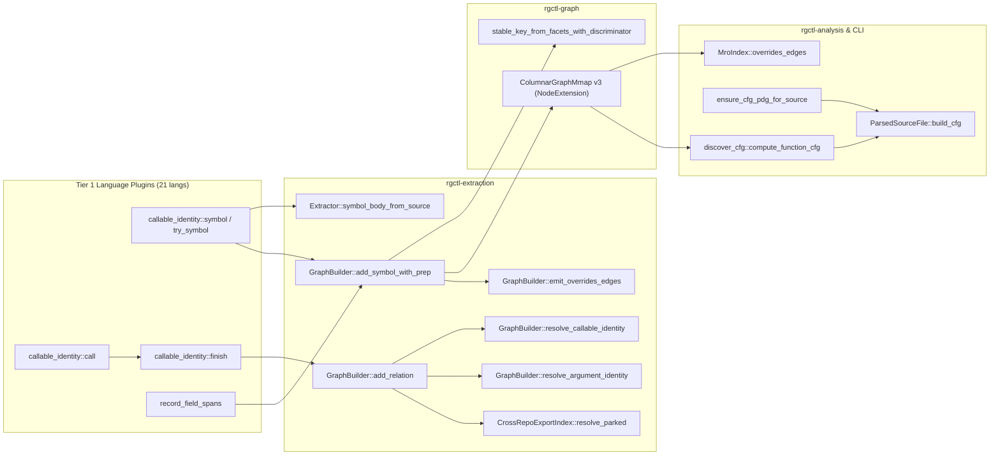

# Review Report

## Overview

- **PR:** [rgctl/rgctl#196 — `fix: preserve Tier 1 callable identity and inherited overrides`](https://github.com/rgctl/rgctl/pull/196)
- **Author:** `shawn-hurley`
- **Base / Head:** `main` (`4d4d1b3f`) → `fix/tier1-callable-identity` (`516d35c2`)
- **Diff Size:** +5,112 / −467 across 68 files (12 commits)
- **Closes / Supersedes:** Closes [#183](https://github.com/rgctl/rgctl/issues/183), supersedes [#184](https://github.com/rgctl/rgctl/pull/184)

## Verdict

🟡 **YELLOW** — The core discriminator architecture for overloaded callable identity (`StableNodeKey`, `NodeExtension` v3, `GraphBuilder` deduplication, MRO dispatch matching, and shared Java field byte spans) solves a real graph-collapse bug (#183), but several concrete correctness bugs (`GroovyPlugin`/`GoPlugin` passing wrong AST nodes to `callable_identity::symbol`, `callable_identity::finish` + `GraphBuilder::add_relation` dropping calls to free/inherited functions when literal arguments are present) and ingest hot-path allocation regressions must be fixed before merge.

### Concerns

1. **Wrong AST node passed to `callable_identity::symbol` in Go and Groovy plugins (Bug):**
   - `crates/rgctl-lang-go/src/plugin.rs:463-468` passes `interface_type` (the enclosing `interface_type` CST node) instead of `child` (`method_elem`) to `callable_identity::symbol`. Every method in a Go interface receives the entire interface's byte span (`source_start_byte`..`source_end_byte`, causing identical interface-wide `code_hash` values) and aggregates parameter lists across all methods in the interface.
   - `crates/rgctl-lang-groovy/src/plugin.rs:1057-1062`, `1138-1143`, and `1172-1177` (in `GroovyPlugin::extract_symbols`) pass `root` (the entire file CST root) instead of `node` to `callable_identity::symbol`. Every extracted method/constructor receives the whole file's byte span and the concatenated parameter lists of every callable in the file.
2. **Unqualified calls to free functions or inherited methods with literal/typed arguments are dropped (Bug):**
   - In `crates/rgctl-plugin-helpers/src/callable_identity.rs:689-704` (`finish`), every `RelationType::Calls` edge with no `to_qualified_hint` and no `.`/`:`/`#` in `relation.to` unconditionally synthesizes `relation.to_type_hint = Some(owner)` and `relation.to_qualified_hint = Some("{owner}{sep}{to}")` from the caller's `qualified_name` (even when `from` is a Rust module-qualified function `mod::caller` or a class method calling a top-level free function `helper(7)`).
   - Then in `crates/rgctl-extraction/src/graph_builder.rs:1052-1097` (`add_relation`), `target` is set to `to_qualified_hint` (`"Owner.helper"`). When the call has literal or typed arguments (`argument_identity_discriminator` is `Some("(int)")`), `resolve_argument_identity("Owner.helper", ...)` and `resolve_callable_identity("Owner.helper", ...)` both return `None` (because the function is `helper`, or is inherited from `Base.helper` via MRO, not `Owner.helper`). Then `else if explicit_to.is_some() || ambiguous_java || signature_call && argument_to.is_some()` forces `to_id = None` without ever calling `resolve_symbol_tracked` (which would resolve via MRO or suffix/free-function lookup).
3. **Ingest hot-path allocations & property duplication (`AGENTS.md` compliance):**
   - `crates/rgctl-plugin-helpers/src/callable_identity.rs:461-470` (`source_span`) inserts `"source_start_byte"` and `"source_end_byte"` into the heap-allocated `symbol.metadata` JSON map for every callable symbol in all 21 languages, only for `GraphBuilder::add_symbol_with_prep` (`crates/rgctl-extraction/src/graph_builder.rs:552`) to filter them out. `Symbol` already has scalar `start_byte: Option<u32>` and `end_byte: Option<u32>`; `extractor.rs:540` and `callable_identity::finish` should read `symbol.start_byte` / `symbol.end_byte` directly.
   - `crates/rgctl-extraction/src/graph_builder.rs:535-581` copies all remaining keys from `symbol.metadata` into `node.properties` (`"identity_discriminator"`, `"override_identity"`, `"parameter_identity"`, `"callable_role"`) and then `with_identity_discriminator` inserts `"callable_identity"` into `node.properties` while `NodeExtensionRef` also serializes `identity_discriminator` in the struct prefix. As a result, the same discriminator string is stored up to **4 times per function node** in `NodeExtension` (`identity_discriminator` field + `properties["callable_identity"]` + `properties["identity_discriminator"]` + `properties["override_identity"]`).
   - In `crates/rgctl-plugin-helpers/src/callable_identity.rs:88-149` and `271-332`, `parameter_groups` and `generic_context` each walk the function header CST via `header_nodes` + `kids` (allocating a fresh `Vec<Node>` per AST node twice per callable), even for languages without generics or overloads (e.g., C on Linux kernel ~600k functions, Python, Go, Bash, Lua).
4. **Warm archive bypass in `ensure_cfg_pdg_for_source` (`crates/rgctl-analysis/src/cfg_pdg_archive.rs:531-539`):**
   - When `opts.function_id.is_none() && opts.start_byte.is_none()`, `ensure_cfg_pdg_for_source` now calls `build_cfg_for_function` (full tree-sitter parse + CFG build) **before** checking `CfgPdgArchiveMmap::open(&archive_path)`, turning warm archive hits into full cold parses.

## Impact Diagram

## Change Set

| Area | Files Touched | Summary |
|------|---------------|---------|
| Graph Identity & Storage | `crates/rgctl-graph/src/{stable_key,schema,columnar_snapshot,snapshot,lib}.rs` | Adds `deterministic_node_id_with_discriminator`, `stable_key_from_facets_with_discriminator`, `Node::with_identity_discriminator`, and bumps `COLUMNAR_SNAPSHOT_VERSION` to `3` (preserving v2 read compatibility). |
| Shared Plugin Helpers | `crates/rgctl-plugin-helpers/src/{callable_identity.rs,callable_identity/java.rs,spans.rs,tree_sitter.rs,lib.rs}` | Adds `Policy`-driven callable discriminator extraction, call-site literal/parameter argument evidence, `finish` pass, and `record_field_spans`. |
| Extraction & Merge | `crates/rgctl-extraction/src/{graph_builder,extractor,facts_cache,merge,callable_resolution,lib}.rs` | Threads discriminators into `symbol_index`, `add_relation`, extraction-time `Overrides`, `CrossRepoExportIndex`, bumps ` facts.bin` `FORMAT_VERSION` to 5, and writes `.rgctl/callable_resolution.json` + `.rgctl/extraction_semantics.json` (v7). |
| Analysis (CFG & MRO) | `crates/rgctl-analysis/src/{cfg_builder,cfg_pdg_archive,mro}.rs` | Rejects ambiguous name-only CFG lookups, keys `MroIndex::methods` as `Vec<Uuid>` per name with `method_identities` / `override_owners` / `signature_families`. |
| Tier 1 Plugins (21 crates) | `crates/rgctl-lang-{bash,c,cpp,csharp,dart,elixir,go,groovy,java,javascript,kotlin,lua,php,puppet,python,ruby,rust,scala,sql,swift,typescript}/**` | Wires `callable_identity::{symbol,call,finish}` across Tier 1 plugins and `record_field_spans` into Java class/enum/interface/record fields. Updates Swift & TypeScript AST coverage JSONs. |
| CLI & Pipeline | `crates/rgctl-pipeline/src/pipeline.rs`, `src/cli/{discover,discover_cfg,discover_impl,pipeline_session}.rs` | Invalidates stale snapshots when `extraction_semantics.json` < v7; selects CFGs by exact byte ranges in `discover_cfg`. |
| Docs & Tests | `docs/design/tier1-callable-identity.md`, `tests/tier1_callable_identity.rs`, `tests/fixtures/**` | Adds 24-language Tier 1 callable identity test suite and design note. |

## Changes

- **Call-path delta (`rgctl review paths`):**
  - `changed_symbols`: 25 (truncated at `--max-symbols 25`)
  - `call_edges`: `+60` added, `0` removed, `2` retargeted
  - `files_in_scope`: 96 (`unscored_files`: 85)

## Blast Radius

| Symbol | File | Score | Direct Callers | Impact Zone Size |
|--------|------|------:|---------------:|-----------------:|
| `GraphBuilder::add_relation` | `crates/rgctl-extraction/src/graph_builder.rs` | 44.95 | 29 | 99 |
| `GraphBuilder::add_symbol_with_prep` | `crates/rgctl-extraction/src/graph_builder.rs` | 43.75 | 3 | 75 |
| `ensure_cfg_pdg_for_source` | `crates/rgctl-analysis/src/cfg_pdg_archive.rs` | 40.15 | 2 | 3 |
| `stable_key_from_row` | `crates/rgctl-graph/src/stable_key.rs` | 25.05 | 1 | 1 |

## Communities

- Touch points span 4 primary architectural communities:
  1. **`rgctl-graph`** (Columnar snapshot v3 layout, `StableNodeKey`, `NodeExtension` zero-copy prefix readers).
  2. **`rgctl-plugin-helpers` + `rgctl-lang-*`** (Worker-side CST extraction across 21 Tier 1 language plugins).
  3. **`rgctl-extraction` + `rgctl-pipeline`** (Pass-1 symbol commit, Pass-2 relation resolution, parked relations, and cross-repo merge).
  4. **`rgctl-analysis` + `src/cli/discover_cfg.rs`** (MRO override resolution and CFG/PDG byte-span lookup).

## Policy Findings

- No `policy.json` configured in repository (`SKIPPED`).
- Checked against `AGENTS.md` mandatory engineering rules:
  - **Ingest hot-path discipline:** Needs cleanup for redundant metadata keys (`source_start_byte`/`source_end_byte`), 4x duplicated discriminator strings in `NodeExtension`, and double CST header traversal (`kids` Vec allocations) on non-generic/non-overloaded languages.
  - **Grammar / AST coverage:** `swift-ast-coverage.json` and `typescript-ast-coverage.json` updated in lockstep with `single_pass.rs`.
  - **Commit trailers:** All 12 commits use DCO `Signed-off-by` only (no AI trailers).

## Test Handoff

1. Add a regression test in `tests/tier1_callable_identity.rs` where a class method (e.g., `Child.caller()` in Java/C++/Rust/C#) calls:
   - a top-level free function `free_helper(7)` with a literal argument, and
   - an inherited base method `baseOnly(7)` (defined on `Base`, not `Child`) with a literal argument.
   Verify that both `Calls` edges resolve and are emitted in the graph.
2. Add a test for `GoPlugin::extract_symbols` on an `interface` with two methods having different signatures and verify each interface method symbol has its own byte span and parameter identity (not the enclosing `interface_type`).
3. Add a test for `GroovyPlugin::extract_symbols` (legacy/plugin path, alongside `extract_all`) with overloaded methods and verify each method gets its own `identity_discriminator` and byte span (not `root`).
4. Run Gate A (`linux_cold_discover_within_baseline`) and Gate B cold profiles after removing redundant metadata allocations in `callable_identity::symbol`.

## Sources

- [AGENTS.md](file:///Users/sshaaf/git/rust/rgctl/rbuilder/AGENTS.md)
- [docs/analysis-architecture.md](file:///Users/sshaaf/git/rust/rgctl/rbuilder/docs/analysis-architecture.md)
- [docs/graph-storage-architecture.md](file:///Users/sshaaf/git/rust/rgctl/rbuilder/docs/graph-storage-architecture.md)
- [docs/design/lossless-writeback-architecture.md](file:///Users/sshaaf/git/rust/rgctl/rbuilder/docs/design/lossless-writeback-architecture.md)
- `.rgctl/review-paths.json`
