# Code structure

Guide for navigating the rgctl workspace: how crates are segmented, how they connect, and where to put new functionality so it is not duplicated elsewhere.

---

## 1. Crate segmentation (overview)

```mermaid
flowchart TB
    subgraph entry["Entry & CLI"]
        RB["rgctl<br/>(binary + src/cli)"]
    end

    subgraph facade["Facade"]
        CORE["rgctl-core<br/>re-exports workspace API"]
    end

    subgraph orchestration["Orchestration"]
        PIPE["rgctl-pipeline<br/>discover / index repo"]
        INC["rgctl-incremental<br/>file tracker, deltas"]
    end

    subgraph extraction_layer["Extraction"]
        EXT["rgctl-extraction<br/>discover files, build graph"]
    end

    subgraph plugins["Plugin system"]
        API["rgctl-plugin-api<br/>LanguagePlugin trait"]
        HELP["rgctl-plugin-helpers<br/>tree-sitter helpers"]
        RUNTIME["rgctl-lang-runtime<br/>generic TS/regex plugins"]
        CFG["rgctl-config-formats<br/>yaml/json/toml/properties"]
        REG["rgctl-registry<br/>LanguageRegistry"]
        LANGS["rgctl-languages<br/>all Tier 1 plugins"]
        LANG["rgctl-lang-*<br/>(language implementations)"]
    end

    subgraph storage["Graph storage"]
        GRAPH["rgctl-graph<br/>CodeGraph, schema, snapshots"]
    end

    subgraph analytics["Graph analytics"]
        ANALYSIS["rgctl-analysis<br/>blast-radius, CFG/PDG, taint, …"]
    end

    subgraph query_export["Query & output"]
        QENG["query engine crate<br/>(internal / not agent API)"]
        EXPORT["rgctl-export<br/>HTML, Mermaid, GraphML, DOT"]
    end

    subgraph cross_cutting["Cross-cutting"]
        SEM["rgctl-semantic<br/>signatures, IDL, types"]
        RULES["rgctl-rules<br/>labeling rule engine"]
        SEC["rgctl-security<br/>CVE / vulnerability patterns"]
        PROJ["rgctl-project-config<br/>.rgctl config, secrets, drift"]
        ERR["rgctl-error<br/>shared Error type"]
        MACROS["rgctl-macros<br/>plugin derive macros"]
    end

    RB --> CORE
    RB --> PIPE
    RB --> ANALYSIS
    RB --> QENG
    RB --> EXPORT

    CORE --> GRAPH
    CORE --> ANALYSIS
    CORE --> PIPE
    CORE --> EXT
    CORE --> QENG
    CORE --> EXPORT
    CORE --> INC
    CORE --> REG
    CORE --> SEM
    CORE --> RULES
    CORE --> SEC
    CORE --> PROJ

    PIPE --> EXT
    PIPE --> GRAPH
    PIPE --> REG

    EXT --> GRAPH
    EXT --> API

    REG --> API
    REG --> CFG
    LANGS --> REG
    LANGS --> LANG
    LANG --> API
    LANG --> HELP
    LANG --> RUNTIME

    ANALYSIS --> GRAPH
    ANALYSIS --> ERR

    QENG --> GRAPH
    QENG --> ANALYSIS

    EXPORT --> GRAPH

    INC --> GRAPH

    SEM --> API
    RULES --> GRAPH
    SEC --> GRAPH
    PROJ --> EXT

    GRAPH --> ERR
    PIPE --> ERR
    EXT --> ERR
    QENG --> ERR

    MACROS -.-> LANG
```

**Reading the diagram:** Data generally flows **down and left-to-right** during `discover`: registry → extraction → graph → analysis → persisted `.rgctl/` artifacts. Query commands (`find`, `blast-radius`, `inspect`) read the graph and analysis layers without re-parsing source unless slicing or CFG is required.

---

## 2. Segmented design (details)

### Design principles

| Principle | What it means in practice |
|---|---|
| **One graph model** | All nodes/edges live in `rgctl-graph`. Do not invent a parallel graph type in CLI or analysis code. |
| **Plugins extract, pipeline orchestrates** | Language-specific parsing stays in `rgctl-lang-*` (via `LanguagePlugin`). File walking and graph assembly stay in `rgctl-extraction` / `rgctl-pipeline`. |
| **Analysis is graph-only** | Algorithms in `rgctl-analysis` take `MemoryBackend`, `PetGraphView`, or snapshots — not raw source files (except CFG/PDG/slice paths that explicitly need source). |
| **CLI is thin** | `src/cli/` parses args, resolves paths, calls library crates. Heavy logic belongs in workspace crates, not new `src/cli/*.rs` helpers. JSON shape lives in `*_output.rs`; graph/cache enrichment stays in `rgctl-analysis`. |
| **Errors are centralized** | Use `rgctl_error::Error` / `Result` from `rgctl-error`. Do not add ad-hoc error enums in the CLI. |
| **All languages always linked** | The binary always includes plugins registered via `rgctl-languages` / [`languages.toml`](../languages.toml) (~60 language/config/IaC plugins). Tier-1 deep-analysis languages additionally ship `*-ast-coverage.json` and single-pass `extract_all` (`ScopeStack` + `KindDispatchTable` + `parse_with_pool`). |

### Layer responsibilities

#### Entry (`rgctl` root crate)

- **`src/main.rs`** — process entry, dispatches to CLI.
- **`src/cli/`** — subcommands: `discover`, `update`, `watch`, `merge`, `find` / `callers` / `callees` / `relations` / `inventory`, `blast-radius`, `serve`, `slice`, `inspect`, `metrics`, `semantic`, `communities`, `clones`, `cpg`, `check`, `review`, `export` (`query` / `pr-check` are compatibility aliases).
- **`src/cli/http_serve.rs`** — `serve`: dashboard + `POST /api/query` (foreground HTTP for one repo).
- **`src/cli/session_status.rs`** — `status`: cheap snapshot / digest / node-edge summary.
- **`src/cli/*_output.rs`** — typed JSON serializers (`blast_radius_output`, `discover_output`, structured-query envelopes, …). Commands assemble domain results from workspace crates and serialize here; **do not** embed algorithm logic in output modules.
- **`src/languages/`** — wires the active language **bundle** into a `LanguageRegistry` at runtime.
- Re-exports **`rgctl-core`** for library users (`use rgctl::analysis`, etc.).

Put new **user-facing commands** here; implement behavior in the appropriate workspace crate.

#### Facade (`rgctl-core`)

Stable “library surface” for embedders: re-exports graph, analysis, pipeline, export, incremental, registry, rules, semantic, security, project-config. Also hosts **`memory`** monitoring helpers used during discover.

If you add a new workspace crate that external tools should use, export it through `rgctl-core` (and optionally the root `rgctl` crate).

#### Plugin system

| Crate | Role |
|---|---|
| `rgctl-plugin-api` | Traits and types: `LanguagePlugin`, `Symbol`, relations, config format plugins. **Contract** all languages implement. |
| `rgctl-plugin-helpers` | Shared tree-sitter/complexity utilities; thread-local `parse_with_pool` / `with_thread_local_parser`. |
| `rgctl-ast-coverage` | Grammar ↔ `*-ast-coverage.json` drift checks; `RGCTL_AST_COVERAGE_STRICT=1` / `RGCTL_AST_COVERAGE_TRACK=1`. |
| `rgctl-lang-runtime` | Config-driven generic plugins (tree-sitter / regex) for simple languages. |
| `rgctl-config-formats` | Non-code config parsers (YAML, JSON, TOML, properties). |
| `rgctl-lang-markdown` | Custom markup plugin for `.md` / `.mdx` (context graph; not Tier 1). |
| `rgctl-registry` | `LanguageRegistry`, dynamic plugin loading, `full_registry()`. |
| `rgctl-languages` | Registers language plugins from the workspace catalog at link time. |
| `rgctl-lang-*` | Per-language implementations (see note below). |
| `rgctl-macros` | `#[derive(LanguagePlugin)]` and related proc macros. |

**Language crates (`rgctl-lang-*`):** One crate per language or config dialect (e.g. `rgctl-lang-java`, `rgctl-lang-github-actions`). Each registers a plugin with the registry. **Do not add parsing logic for an existing language in another language crate** — extend the relevant `rgctl-lang-*` plugin instead. For Tier 1 / full analysis parity, see [tier-1-language-support.md](tier-1-language-support.md).

#### Ingestion pipeline

| Crate | Role |
|---|---|
| `rgctl-extraction` | `FileDiscoverer`, `Extractor`, `GraphBuilder` — turns plugin output into graph mutations; parks unresolved cross-repo relations (`parked_relations.bin` / `RBPK`). |
| `rgctl-pipeline` | `ProcessingPipeline` — parallel repo processing, progress, stats; calls extraction + graph. |
| `rgctl-incremental` | `FileTracker`, change detection, incremental graph updates between discovers. |

**Discover flow:** `CLI discover` → `discover_impl` → `ProcessingPipeline` → plugins → `CodeGraph` → analysis passes → write `.rgctl/`.

#### Graph storage (`rgctl-graph`)

- **`CodeGraph`** — high-level API over the backend.
- **`backend/`** — `MemoryBackend`, indexes, batch insert, query.
- **`schema/`** — `Node`, `Edge`, `NodeType`, `EdgeType`.
- **`snapshot/`** — default **`RGCL` v2** columnar mmap (`graph.snapshot.bin`, 64B node / 40B edge rows + string arena + `cold_ext`); v1 bincode still readable. `SnapshotNodeStore`, `ColumnarGraphMmap`.
- **`graph_compactor.rs`** — `DeltaSegment` + `GraphCompactor` for incremental rewrites.
- **`export/` / `import_json`** — JSON serialization (legacy `graph.db` / `graph.json` via `--write-json-graph` only).
- **`query/`** — simple string queries over the backend.

**All persistent graph topology** belongs here. Analysis results that attach to nodes may use `rgctl-analysis::results` columnar tables, not new graph backends.

#### Graph analytics (`rgctl-analysis`)

Single home for **graph algorithms and semantic analysis**:

| Module area | Examples |
|---|---|
| Impact / structure | `blast_radius_scc`, `blast_engine_snapshot`, `macro_call_index`, `macro_call_lookup`, `graph_utils` (`filter_impact_by_caller_depth`, `PetGraphView`), `dependency`, `callgraph` |
| Metrics | `centrality` (`FastPageRank`, `SampledBetweenness`, `HyperBallHarmonic`, `NodeRole`), `community` (Fast-Leiden + `HubStripPolicy`), `complexity` |
| Control / data flow | `cfg`, `cfg_builder`, `pdg`, `dominance`, `dataflow`, `def_use`, `slicing`, `interprocedural_*`, `cfg_pdg_archive` (lazy v3) |
| Clones / MRO / overlays | `clones`, `fragment_clones`, `mro`, `scip_overlay`, `git_churn` |
| Security-ish analysis | `taint`, `policy` |
| Projections | `graph_utils` (`PetGraphView`) |
| Persistence | `results` (columnar analysis tables), `storage` |
| Handoff | `blast_slice_handoff` (blast → slice seeds) |

**Do not reimplement** SCC blast radius, PageRank, Fast-Leiden community detection, or CFG building outside this crate.

#### Query & export

| Crate | Role |
|---|---|
| `rgctl-export` | Dashboard HTML, Mermaid, Graphviz/DOT, GraphML; subgraph selection from graph queries. |

#### Cross-cutting

| Crate | Role |
|---|---|
| `rgctl-semantic` | Function signatures, type inference helpers, IDL generation — source-level semantics, not graph storage. |
| `rgctl-rules` | Declarative rulesets for automatic node labeling. |
| `rgctl-security` | Security analyzer and CWE/CVE pattern matching over graph/content. |
| `rgctl-project-config` | `.rgctl` project file, config drift, secret detection in config files. |
| `rgctl-error` | Shared `Error` enum used across crates. |

### Where CLI commands map

| Command | Primary crates |
|---|---|
| `discover` | `pipeline`, `extraction`, `registry`, `graph`, `analysis`, `incremental`, `export`, `project-config`; stdout JSON via `discover_output` when `-f json` |
| `update` / `watch` / `merge` | `incremental`, `graph` (`GraphCompactor`), `extraction` (parked relations) |
| `blast-radius` | `analysis` (engine + macro index + depth filter), `graph` (columnar snapshot mmap); CLI orchestration in `blast_radius.rs` |
| `serve` | `http_serve` — foreground HTTP dashboard + `/api/query` |
| `status` | Session graph presence / digest / counts |
| `find` / `callers` / `callees` / `relations` / `inventory` | `graph` (structured query) |
| `slice` / `cpg flows` | `analysis` (lazy `ensure_cfg_pdg_for_source`, PDG, slicing) |
| `inspect` | `graph`, `analysis` |
| `metrics` | `analysis` (centrality, community, git churn) |
| `clones` | `analysis` (`clones`, `fragment_clones`) |
| `check` / `review check` | `analysis` (policies, blast radius, temporal ledger) |
| `export` | `export`, `graph` |

### On-disk artifacts (`.rgctl/`)

Understanding files helps avoid duplicating cache layers:

| File | Produced by | Consumed by |
|---|---|---|
| `graph.snapshot.bin` | `discover` / `update` / `merge` (`RGCL` v2 default) | `CodeGraph::open_snapshot`, `SnapshotNodeStore`, `ColumnarGraphMmap`, `serve` |
| `graph.db` / `graph.json` | `discover --write-json-graph` only | Legacy load paths |
| `facts/` | `discover` / `update` | Per-file extraction facts cache |
| `parked_relations.bin` | `discover` (unresolved cross-repo) | `rgctl merge` park-and-resolve |
| `blast_engine.snapshot.bin` | `discover` | `try_load_engine`, lite blast-radius path, `serve` |
| `macro_call_index.db` / `.bin` | `discover` | `blast-radius` T0 fast path only — SQLite/bincode lookup cache, not the graph |
| `analysis/cfg_pdg.archive.bin` | `discover --with-cfg`, or lazy append from `slice` / `cpg flows` | `inspect`, slice, `cpg`, `blast-radius --with-slices` |
| `analysis/git_churn.json` | `discover --with-git` | `metrics --churn`, `relations --edge cochangeswith` |
| `query.sock` | *(retired)* | Former blast-radius Unix-socket client (v0.4.7); removed with daemon mode |
| `analysis_results.bin` | `discover` | Columnar metrics (`CentralityTable`, community, blast); blast columns may stay empty on flat/on-demand graphs (bulk fill skipped — #28 won't-fix; use live `blast-radius`) |
| `dashboard/` (bundle) | `discover --with-universe` | Browser static universe/dashboard (`index.html`, `manifest.json`, `graph_payload.bin`) |

---

## 3. Crate reference (non-language)

Alphabetical list of workspace crates **excluding** individual `rgctl-lang-*` plugins.

| Crate | Path | Purpose |
|---|---|---|
| **rgctl** | `.` | CLI binary, command dispatch, language bundle wiring, public library root. |
| **rgctl-analysis** | `crates/rgctl-analysis` | Graph algorithms: blast radius, FastPageRank / SampledBetweenness / HyperBall, Fast-Leiden, CFG/PDG, slicing, taint, clones, MRO, SCIP, git churn, policies, caches, `PetGraphView`. |
| **rgctl-ast-coverage** | `crates/rgctl-ast-coverage` | Grammar ↔ coverage-manifest drift (`RGCTL_AST_COVERAGE_STRICT` / `_TRACK`). |
| **rgctl-dashboard** | `crates/rgctl-dashboard` | Static dashboard bundle generation. |
| **rgctl-gql** | `crates/rgctl-gql` | Graph query language (`rgctl gql`). |
| **rgctl-kantra** | `crates/rgctl-kantra` | Konveyor Kantra rule eval + embedded catalog. |
| **rgctl-languages** | `crates/rgctl-languages` | Registers language plugins from the workspace catalog (`languages.toml`). |
| **rgctl-config-formats** | `crates/rgctl-config-formats` | Config file plugins (YAML, JSON, TOML, properties). |
| **rgctl-lang-markdown** | `crates/rgctl-lang-markdown` | Markdown context graph (headings, links, frontmatter). |
| **rgctl-core** | `crates/rgctl-core` | Facade crate re-exporting the stable library API for embedders. |
| **rgctl-error** | `crates/rgctl-error` | Shared error types (`Error`, `Result`) for the whole workspace. |
| **rgctl-export** | `crates/rgctl-export` | Export graph and analysis to HTML dashboard, Mermaid, GraphML, Graphviz. |
| **rgctl-extraction** | `crates/rgctl-extraction` | File discovery, extraction orchestration, graph building from plugin output. |
| **rgctl-graph** | `crates/rgctl-graph` | Code knowledge graph storage, schema, indexes, JSON import/export, mmap snapshots. |
| **rgctl-incremental** | `crates/rgctl-incremental` | Incremental updates, file tracking, change detection between indexing runs. |
| **rgctl-lang-runtime** | `crates/rgctl-lang-runtime` | Generic tree-sitter and regex language plugins from static config. |
| **rgctl-macros** | `rgctl-macros` | Procedural macros for language plugin boilerplate. |
| **rgctl-pipeline** | `crates/rgctl-pipeline` | Parallel repository processing pipeline (discover/index entry point). |
| **rgctl-plugin-api** | `crates/rgctl-plugin-api` | Core plugin traits, symbol/ relation types, config format registrar. |
| **rgctl-plugin-helpers** | `crates/rgctl-plugin-helpers` | Shared extraction helpers (tree-sitter utilities, complexity calculator). |
| **rgctl-project-config** | `crates/rgctl-project-config` | Project-level config, secret scanning, config drift analysis. |
| **rgctl-registry** | `crates/rgctl-registry` | Language plugin registry and optional dynamic plugin loading. |
| **rgctl-rules** | `crates/rgctl-rules` | Rule engine for automatic graph labeling from declarative rulesets. |
| **rgctl-security** | `crates/rgctl-security` | Security vulnerability analysis and CWE pattern library. |
| **rgctl-semantic** | `crates/rgctl-semantic` | Signature extraction, type inference, IDL generation from source. |

### Language implementations (`rgctl-lang-*`)

There are many crates named `rgctl-lang-<language>` (and a few for CI/config dialects). Each implements `LanguagePlugin` (or a config plugin) for one language or format. They are registered through **`rgctl-registry`** and **`rgctl-languages`** — not linked directly from analysis or graph code.

When adding or fixing language support:

1. Change or add a **`rgctl-lang-*`** crate.
2. Register it in **`rgctl-languages`**.
3. Do **not** add language-specific parsing to `rgctl-analysis` or `src/cli/`.

---

## Quick “where do I put this?” table

| I want to… | Put it in… |
|---|---|
| Parse a new language construct | Relevant `rgctl-lang-*` plugin |
| Add a graph edge type or node property | `rgctl-graph` schema + migration |
| Add a graph algorithm (impact, metrics, flow) | `rgctl-analysis` |
| Add a CLI flag or subcommand | `src/cli/` + call into library crate |
| Add `--depth` or query-tier behavior | `graph_utils` filter + `blast_radius.rs` paths (cache, lite, full) |
| Add CLI JSON schema / field | `src/cli/<command>_output.rs` + `tests/cli_output/` (Layer 1) |
| Add subprocess regression for CLI | `subprocess_golden_path.rs` (narrow) or `all_commands_sanity.rs` (full audit) + `tests/fixtures/` — see [`cli-io-sanity-qe.md`](cli-io-sanity-qe.md) |
| Add a structured query filter or verb | `rgctl-graph` + `src/cli/structured_query.rs` |
| Add HTML/Mermaid/GraphML output | `rgctl-export` |
| Add a discover-time cache file | `discover_impl` writer + relevant analysis/graph module reader |
| Add a labeling or policy rule | `rgctl-rules` or `rgctl-analysis::policy` |
| Add shared error variant | `rgctl-error` |

---

*Related docs: [`user-guide.md`](user-guide.md), [`json-api.md`](json-api.md), [`guides/cli-command-reference.md`](https://rgctl.io/docs/guides/cli-command-reference/), [`dashboard-design.md`](dashboard-design.md), [`cli-io-sanity-qe.md`](cli-io-sanity-qe.md), [`graph-storage-architecture.md`](graph-storage-architecture.md), [`CLI_STRUCTURE.txt`](CLI_STRUCTURE.txt).*
