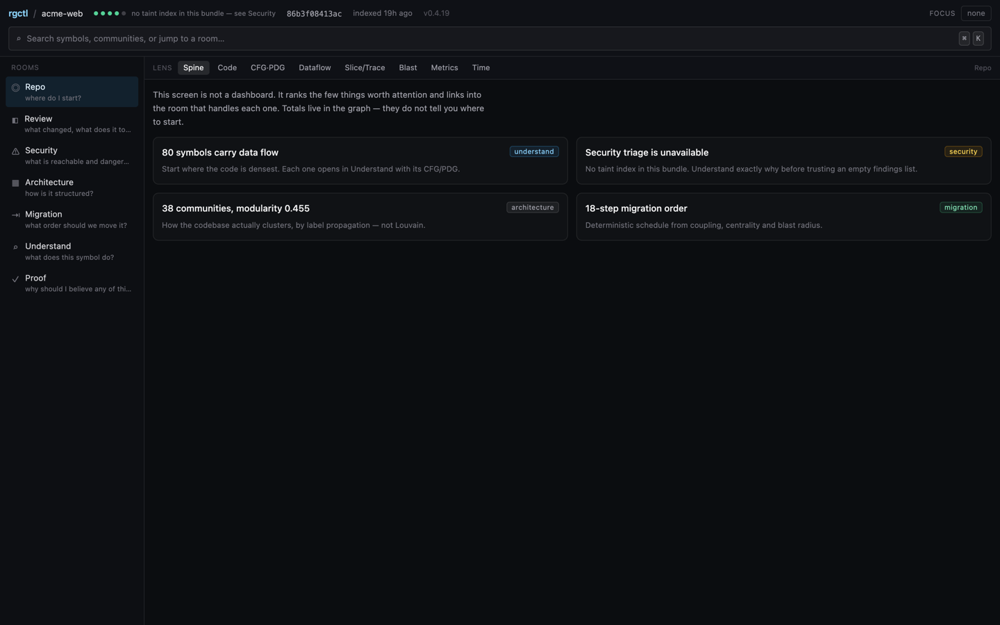
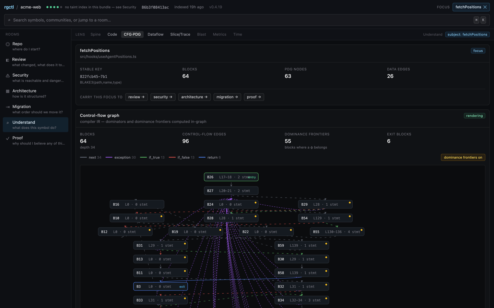
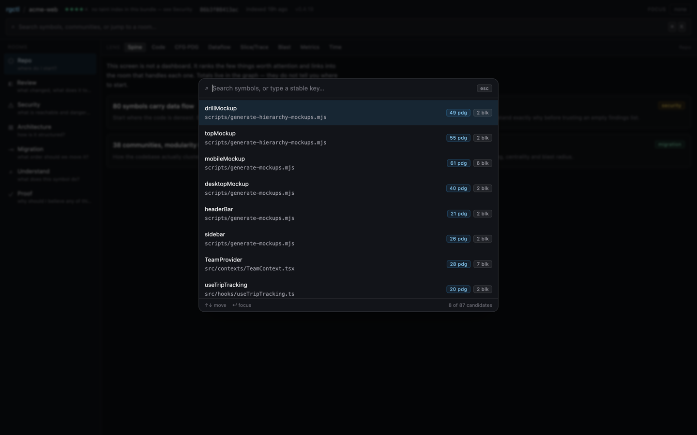
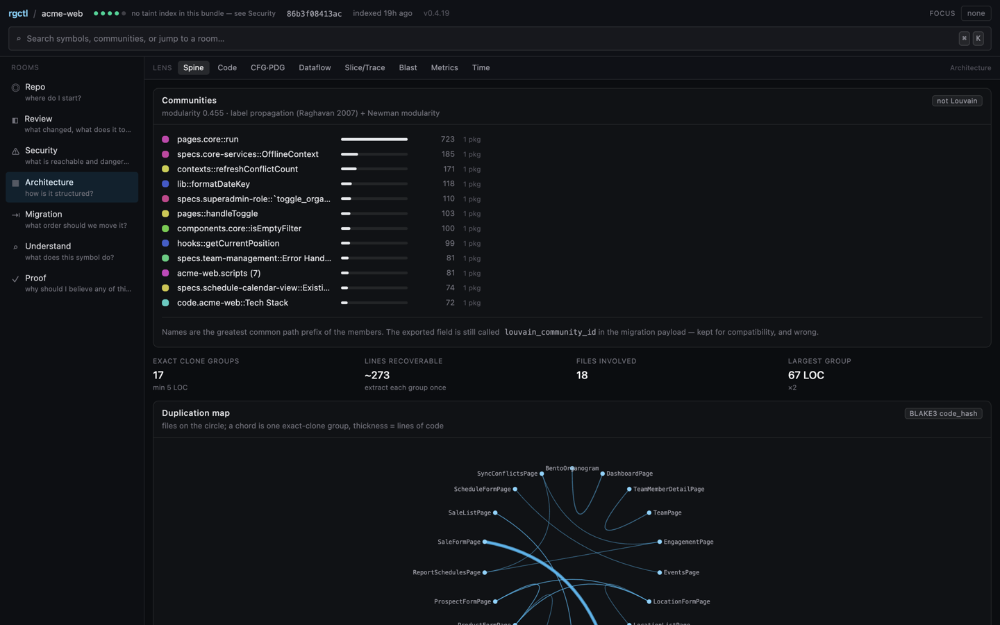
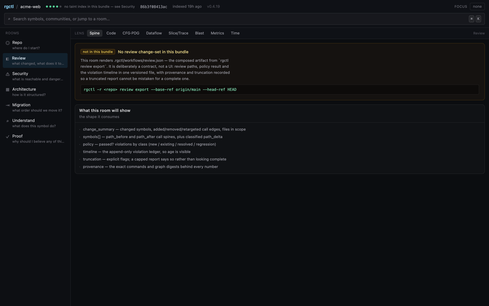
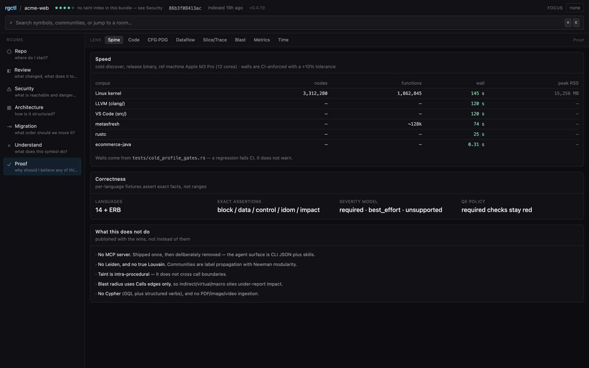
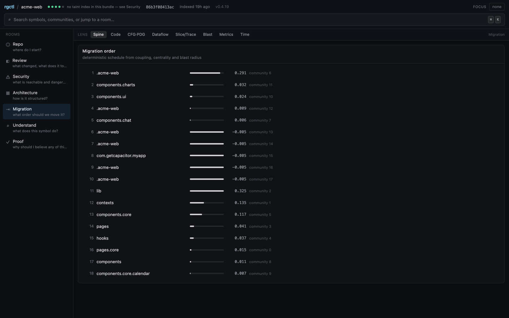

# rgctl Dashboard v2 — design

**Status:** Proposal — design only, nothing implemented yet
**Goal:** Turn the deterministic code knowledge graph into **decisions you can defend** — locally, in milliseconds, with a receipt for every number.
**OpenSpec (local):** umbrella over `openspec/changes/add-dashboard-v2-shell/` and the room changes listed in [Change sequence](#change-sequence)
**Relationship to v1:** Additive. This document does **not** replace [dashboard-design.md](dashboard-design.md), which remains the living design for the shipping Preact dashboard until v2 reaches parity.

**Non-goals (v2.0):** Replacing the WASM engine or the columnar v2 payload; adding a server or cloud tier; a second graph format; making the graph canvas the primary surface.

---

## Why

The engine underneath the dashboard is substantially stronger than the dashboard that exposes it. rgctl computes interprocedural slices, compiler IR (CFG, dominance frontiers, PDG, reaching definitions), SCC-condensed reachability, temporal diffs, and clone groups — all locally, deterministically, in milliseconds. Little of that reaches a user through the current UI.

v2's job is **not** more graph. It is to convert existing, already-correct engine output into answers a reviewer, a security engineer, or an architect can act on and cite.

### Evidence of the gap

A live audit of the shipping dashboard (indexing a 5,345-node / 11,801-edge TypeScript repo) found:

- All six deep-analysis views (**CFG, Dataflow, Slice, Blast, Taint, Kantra**) render blank on arrival and need manual multi-step selection before showing anything.
- The two views that *do* render on load (Graph, Migration) open to unreadable overlapping node piles.
- The always-visible stat row renders **"Filtered Nodes" with an identical value to "Total Nodes"** (`dashboard/src/App.tsx:98` and `:104` both read `manifest?.graph.node_count`).
- The Metrics columns in the Functions table read `—` for every row on a real repo, and the dashboard does not say why.

Net effect: the dashboard currently demonstrates **none** of the engine's differentiating capabilities. The full defect list, with `file:line` receipts, lives in the tracking issue; the individually-fixable ones ship separately and ahead of v2.

---

## Philosophy

Seven rules. Every design decision below must be traceable to one of them.

1. **Answer first, graph second.** Open on a conclusion and its evidence. The graph is one way to inspect that evidence — never the landing page.
2. **Every number carries a receipt.** Any score, count, or verdict exposes its inputs and the command that produced it. No unexplained integers.
3. **Lenses, not tabs.** CFG, Dataflow, Slice, Blast, Metrics, and Time are *ways of looking at the current subject*, not destinations that reset your context.
4. **One focus, many views.** Selection is ambient and portable, not per-view.
5. **Honest about its own limits.** If taint is intra-procedural, if blast traverses only `Calls`, if a metric is an approximation — say so in the surface where the number appears, not in a footnote.
6. **Show the command.** Every view can emit the CLI equivalent that reproduces it.
7. **Local, instant, private.** No CDN, no telemetry, no cloud tier, no network at runtime.

---

## Information architecture

The v1 tab bar treats lenses as destinations and has grown to **11 top-level tabs** (`dashboard/src/tabIcons.ts:10-22`), which wrap to two rows at 1440px. v2 replaces destinations with the following:

```
INSTRUMENT   (persistent; never a destination of its own)
             coverage ●●●○○  ·  digest  ·  freshness  │  ⌘K omnibox  │  ◆ Focus bar

ORIENTATION  (exactly one)
             Repo — decision-shaped: "where do I start?", never vanity counts

ROOMS        (n; each answers one question end-to-end)
             Review ⭐ · Security ⭐ · Architecture · Migration · Understand · Agent · Proof

LENSES       (shared control, never top-level)
             Spine · Code · CFG·PDG · Dataflow · Slice/Trace · Blast · Metrics · Time
```

**Orientation is not a dashboard.** "Repo" answers *where do I start* by ranking the few things worth attention (unreviewed change surface, risk-weighted findings, drift, coverage caveats) and linking into the room that handles each. It does not print totals.

**Rooms are jobs, not features.** Review = "what changed and what does it touch?" Security = "what is exploitable and what is reachable?" Proof = "why should I believe any of this?"

**Lenses are filters on the current focus.** Switching lens never changes what you are looking at.

---

## The Focus mechanism

The core interaction is a single, portable **Focus**: one stable key derived from the symbol's `(path, name, type)` rather than a database row id, selected once and carried between rooms.

**What the key survives, precisely.** It survives **re-indexing** — row order and node indices can change
underneath it and a stored Focus still resolves. That is the property the URL needs, and it is what
positional node identity cannot do.

It does **not** survive a **rename**, and an earlier draft of this document claimed it did. The key
contains the name, so renaming a symbol produces a different key and an old link stops resolving; the same
applies to the engine's `path \x1f name` form. Rename-survival would need either an explicit
old-key→new-key resolution step — the engine tracks resolved/renamed nodes in `snapshot_diff`, so it is
achievable — or identity derived from content rather than name. Neither is built, so the shell renders a
stale Focus as an explicit "does not resolve against this bundle" state rather than pretending.

While the claim went unnoticed it was load-bearing: "carry this symbol to another room" reads differently
if the carrier expires the first time someone renames a function.

Consequences:

- Select a symbol in **Review**, carry it to **Security** (findings filtered to what that symbol can reach), then to **Architecture** (its coupling), then to **Time** (its drift).
- The Focus serializes into the URL, so any state is a shareable link: `?focus=<key>&room=security&lens=blast`.
- **This is the differentiator.** Tools whose node identity is positional cannot express it, because their selection does not survive the next commit.

Focus is *ambient*: it constrains rooms, it is never a prerequisite to render one. A room with no Focus must still open on a useful default (rule 1).

---

## Stack

| Concern | Choice | Why |
|---|---|---|
| Framework | **React 19** | Every choice below depends on it; the evidence for the switch is in the next section |
| Routing | **TanStack Router** — typed routes, validated search params | All view state *is* search-param state (`room`, `lens`, `focus`), so it has to be a shareable URL. Typed, validated params stop the Focus key from degrading into a stringly-typed free-for-all |
| Caching | **`@tanstack/react-query`** | Artifacts are immutable per `graph_digest`, so `staleTime: Infinity` on a digest-keyed cache. The React bindings are the intended entry point — no hand-wired store subscription |
| Tables | **`@tanstack/react-table`** + **`@tanstack/react-virtual`** | 300k-node lists without DOM blowup; headless, so rendering and styling stay ours |
| Components | **Radix Primitives** + Tailwind (shadcn/ui optional on top) | The overlay primitives rooms need — dialog, popover, dropdown, tooltip, select, command palette — with focus management, dismissal and ARIA already solved |
| Client state | **Zustand** | Client-only state, storing **references** (keys and ids), never payloads |
| 3D | **three.js + `@react-three/fiber`** | Only where depth is genuine data (below); R3F for declarative scene composition and instancing |

### Decision: migrate to React

**Decided: migrate to React.** The deciding evidence is a spike that was run to justify *staying* on
Preact and returned the opposite answer. It is recorded in full below rather than summarised, because the
argument for this reversal is entirely empirical.

The objection to migrating was cost: 9.7k LOC across every view. **That objection is weaker than it
looked**, because v2 is additive behind a flag and ships as its own bundle. v1 keeps its Preact code and
its 18 test files untouched until v2 reaches parity; the legacy views are then deleted rather than
ported. The migration is therefore *deferred*, not avoided — and by the time it is forced, the code being
migrated is code we intend to delete.

### Why React: the evidence

This section exists to justify a reversal, so it records the measurement rather than the conclusion. If
you are reading the design rather than auditing the decision, the stack table above is the outcome and
this is the reasoning behind it.

`@preact/preset-vite` aliases `react` → `preact/compat` and the shim reports itself as React 18.3.1 to
version-sniffing libraries. Each candidate below was **rendered or driven**, not merely imported.

| Candidate | Result | Evidence |
|---|---|---|
| `@tanstack/query-core` | ✅ keep | digest-keyed cache; `staleTime: Infinity` did not refetch; a different digest did |
| Zustand vanilla + `useSyncExternalStore` | ✅ keep | Focus key round-trips; subscribers re-render |
| Hand-rolled `URLSearchParams` + `history` | ✅ works | `focus`/`room`/`lens` round-trip with no library |
| `preact/compat` `createPortal` | ✅ works | renders into a target host |
| Radix, **non-portal** primitive | ✅ works | `role="dialog"` with `aria-labelledby` wired — `useId`, `forwardRef`, context all fine |
| **Radix `Dialog.Portal`** | ❌ **fails** | renders nothing; throws `InvalidCharacterError: "[object Object]" did not match the QName production` |
| **`wouter` 3.13** | ❌ fails | peer-depends on `react`, ships no Preact entry, binds the real React in `node_modules` via `useSyncExternalStore` |
| TanStack Router | ❌ unavailable | React/Solid only |
| `@react-three/fiber` | ❌ unavailable | needs React's reconciler |

The failure is specific to **portals as Radix uses them** — `preact/compat`'s own `createPortal` is fine.
But that is precisely the set a rooms UI depends on: dialog, popover, dropdown, tooltip, select, command
palette. The components that *do* work under the shim (button, card, badge, input, table, tabs) are the
ones worth hand-rolling anyway.

**A latent hazard makes this worse than a one-off incompatibility:** `npm install @radix-ui/*` pulls
**real React 19** into `node_modules` as a peer dependency. Any React-shaped library can then silently
bind to it instead of the shim, and fail in a way that looks like our bug rather than a stack problem.
On React that entire class of failure disappears.

**The same spike also showed React is not expensive here.** Measured with esbuild `--minify` then gzip:

| Runtime | Minified | Gzipped |
|---|---|---|
| React + `react-dom/client` | 217 KB | **67 KB** |
| Preact | 10 KB | **4 KB** |

So React costs **~63 KB gzipped more**. The shipping bundle is **1.7 MB** and served locally — CodeMirror
alone is 146 KB gzipped — so this is roughly **2%**. Shipping 63 KB to stop fighting a shim is not a close
call; the usual Preact-versus-React size argument simply does not apply to a bundle embedded in a binary.

*Alternatives rejected:* staying on Preact and hand-rolling overlays (the spike above says the shim will
keep costing us); hybrid islands (two runtimes in one bundle is a permanent tax).

### Prototype

A working, clickable mock was built on this stack with real data from a live `.rgctl/` — React 19 +
TanStack Router + Radix + Tailwind, **583 KB / 167 KB gzipped** including 259 KB of dataset. It
demonstrated the shell, the Focus carried across rooms and lenses through typed route params, and — as
the decisive artefact — a Radix `Dialog.Portal` rendering correctly where the Preact build produced
nothing.

**The mock has served its purpose and is retired.** The screenshots below are the record;
they are committed rather than linked to a running app, and the prototype code is tagged
`mock-v2-prototype` in this repository rather than carried forward. Design decisions should now be
settled in the real implementation, where they can be tested against a real graph.

| | | |
|---|---|---|
|  |  |  |
| **Orientation** — "this screen is not a dashboard"; it ranks what to look at and links into rooms. | **The Focus, carried** — one `StableNodeKey` with the "carry this focus to" affordances, beside real compiler IR: 64 blocks, 96 edges. The mock's "55 dominance frontiers" is **not** 55 φ sites — see the correction below. | **The decisive artefact** — a Radix `Dialog.Portal` rendering. The same code renders *nothing* through `preact/compat`, and that is why the framework changed. |
|  |  |  |
| **Architecture** — modularity 0.455, badged **"not Louvain"**, plus 17 exact clone groups and a chord map of duplication. It also admits the exported field is still misnamed. | **Review** — an honest empty state, and the contract it consumes. That contract is `rgctl review export`, submitted separately as sshaaf/rgctl#117. | **Proof** — the limits published beside the wins, which is the point of the surface. |
|  | | |
| **Migration** — a deterministic schedule from coupling, centrality and blast radius. | | |

What the prototype does **not** show, and why it was retired rather than extended: it has no WASM
engine, so nothing is driven by a real graph; the `Code` lens reports a *count* of source lines rather
than source; and `Spine` renders an empty state because the caller/callee index is not in its dataset.
The maintainer's parking comment on [issue #61](https://github.com/sshaaf/rgctl/issues/61) named the code
browser as *the* missing piece — so the next step is the real app, not another prototype. See
[open question 4](#open-questions).

### Correction: the direction of `dominance_frontiers`

The prototype counted **55 dominance frontiers** for the 64-block function above by taking the number of
blocks whose frontier row is non-empty, and labelled it "blocks where a φ belongs". That reading is
backwards, and it is worth recording because the screenshot cannot be corrected and a later reader will
otherwise read the live lens as broken when it reports a much smaller number.

The bundle writes `dominance_frontiers[i] = DF(i)` — `crates/rgctl-dashboard/src/cfg_export.rs` builds it
from `DominatorTree::frontier`, which is the standard relation, and its one consumer agrees:
`crates/rgctl-analysis/src/pdg.rs` walks `frontier(block_id)` to attach control dependence *from* the
controller in `block_id` *to* the block it yields. So a row is "the joins a φ for definitions made in
block `i` belongs in", and the block that *has* a non-empty row is not the φ site.

The φ site is a block that **appears** in some row. Checked against a real bundle rather than argued:
`toggleActive` (`MaterialsPage.tsx`) has `DF(2) = DF(5) = [0]`, and block 0 is its only block with two
predecessors — the merge. For the 64-block function, 55 blocks carry a non-empty frontier row and 5 blocks
are φ sites.

`dashboard/src/v2/rooms/CfgGraph.tsx` builds the dot set as the union, and
`dashboard/src/v2/data.ts` states the direction beside the type so the next call site does not re-derive it.
The v1 dashboard's own `CfgView` was not changed.

### Consequences

- **v1 is untouched.** `--with-dashboard` keeps producing the existing Preact bundle, so all 18 dashboard
  test files stay meaningful and the change stays bisectable.
- **No dual runtime.** v2 is a separate bundle behind a flag, so React and Preact are never both loaded.
- **The Preact → React migration of v1 is deferred**, and should happen only at the point the legacy
  views are deleted.
- **Harness work still required:** `dashboard/vitest.config.ts` declares **no plugins and no DOM
  environment**, so no component test can run today. Change 1 must add the React plugin and a DOM
  environment. This one is not framework-specific — it was needed either way.

### What the framework change reclaims

Three capabilities had been designed *around* rather than chosen, because `preact/compat` could not
provide them. All three are now available again, and the stack table above reflects that:

| Was going to be | Now is | What it buys |
|---|---|---|
| hand-rolled `URLSearchParams` + `popstate` | TanStack Router | typed, validated route params; loaders; no bespoke routing to maintain |
| hand-rolled overlays on `preact/compat`'s `createPortal` | **Radix Primitives** | focus traps, dismissal, scroll locking, ARIA wiring — the parts that are tedious to get right |
| three.js mounted imperatively | `@react-three/fiber` | declarative scene graph for change 4 |

**The design itself is unaffected.** The framework never constrained the parts that matter: the
Instrument/Orientation/Rooms/Lenses architecture, the portable `StableNodeKey` Focus, the receipts, or
the honesty rules. Those were decided on product grounds and survive the switch intact. What changed is
what the shell is built out of, not what it does.

*Prototype note:* the mock now routes through **TanStack Router** rather than the hand-rolled
`URLSearchParams` + `popstate` it started with, so it demonstrates the routing choice as well as the
Focus mechanism — a `focus` and `lens` survive a view change, a reload, and a shared URL. It was ported
after the framework decision rather than before, which is why the earlier note here said otherwise.


### Where 3D is justified

3D only where depth encodes real data. Approved: Code City (architecture), blast-depth shells, trace-as-call-depth, time-lapse drift. **Not** approved: the package or call graph — those are 2D problems and 3D makes them worse.

---

## Constraints

The bundle is embedded into the binary at compile time via `include_dir` from `dashboard/dist`, and must work with no network.

- **No CDN** — including fonts and icons. Self-host fonts; bundle icons locally. (Icons are currently Bootstrap Icons, already local.)
- **Self-contained** — `.rgctl/dashboard/` needs no network and no backend, but it does need an **origin**:
  serve it with any static server, or with `rgctl serve`. It does **not** currently work from `file://`, and
  an earlier version of this line claimed it did.
  The blocker is not routing, which is what it looks like. Vite emits
  `<script type="module" crossorigin src="./assets/…">`, and Chrome refuses to execute module scripts from a
  `file://` origin — the origin is opaque, so CORS applies and the script never runs. Measured: the page
  loads, the script tag is present, `root` stays empty and nothing renders. The module *worker* is the same
  story (`useEngineWorker.ts` passes `{ type: "module" }`), so the engine would not start either.

  This is true of v1 as well — its built `index.html` carries the same `type="module" crossorigin` — so it
  is a property of the Vite build, not of v2. `inject_manifest_bootstrap` exists precisely to bootstrap
  offline, which shows the intent was there; the module boundary is what defeats it.

  Real `file://` support means a non-module build: an IIFE bundle and a classic worker. That costs code
  splitting (v1's `manualChunks` for sigma, graph-layout and CodeMirror) and changes how the engine worker
  loads, so it is a build-pipeline change and not a flag. Not attempted: serving the directory is one
  command, and claiming an offline capability that does not work is worse than not having it.
- **Bundle size is a gate.** Add a size check to `scripts/build-dashboard.sh` so the embedded-bundle cost is tracked per PR.
- **No new required backend dependencies.** v2 consumes the existing columnar v2 payload and JSON sidecars.
- **Client routes need a server that knows about them.** v2 is the first dashboard with real paths: v1 was
  tabs, so its URL never changed and a reload always asked for `/`. v2's routes are `/$roomId` with
  `?lens=…&focus=…` as search params, so a reload asks the server for `/understand` — and a static file
  server has no such file. `rgctl serve` answered `404` with an empty body, which is a blank page: the shell
  never loaded and the router that would have read the URL never ran. `dashboard_fallback` now answers a
  route with `index.html` (see `is_client_route`), canonicalises a trailing slash with a redirect, and still
  refuses to answer a *file* request (`/assets/x.js`, `/favicon.ico`) or an API path with the shell.
  Anyone serving `.rgctl/dashboard/` with their **own** static server needs the same rule — an SPA fallback
  to `index.html` — and it is not something `rgctl serve` can install on their behalf.

### Two build hazards to fix while adding the size gate

1. **`dashboard/dist` is tracked** (34 files; `.gitignore:34` only ignores the root `/dist`), and `crates/rgctl-dashboard/src/bundle.rs:7` embeds it with `include_dir!("…/dashboard/dist")`. Source changes under `dashboard/src/` therefore have **no effect** on the shipped dashboard until `dist` is rebuilt and committed — which is why `dist` must be regenerated inside any UI PR.
2. **`scripts/build-dashboard.sh:13-19` writes a throwing stub** when `wasm-pack` is missing, and `npm run build` then happily bundles it. A contributor without `wasm-pack` can silently replace the real ~190 KB `rgctl_wasm_bg-*.wasm` with a stub that throws at runtime, and commit the result. The script should fail loudly (or refuse to overwrite an existing real engine) instead.

---

## Additive strategy and compatibility

v2 ships **additively, behind a flag**, and v1 keeps working until parity is proven.

Rationale: the dashboard surface is guarded by **18 test files** in `tests/` — `dashboard_bundle.rs`, `dashboard_gbuilder.rs`, `dashboard_harness.rs`, `dashboard_metasfresh.rs`, `with_dashboard_cli.rs`, and 14 per-language `dashboard_ecommerce_*.rs` — plus the offline-bundle and `include_dir` guarantees. A big-bang rewrite red-lines all of them at once and destroys the ability to bisect.

Rules:

- `--with-dashboard` (v1) keeps working; v2 is opt-in until parity.
- `tests/dashboard_harness.rs` is extended with v2 parity assertions rather than replaced.
- Manifest gains a phase bump and `dashboard_version` on every change (`crates/rgctl-dashboard/src/manifest.rs:54`).

> **Prerequisite (fixed):** every phase PR is supposed to run `./scripts/test-dashboard-golden.sh`
> (`dashboard-design.md:184`, `:251`, `:310`, and `contributor-checklist.md:134`, `:143`).
> That script — and `test-dashboard-metasfresh.sh` — had been accidentally deleted in `4dcc35d`
> ("update README and cleanup"), while four live references to them survived, so the documented
> per-phase gate could not be run at all. Both are restored and modernized to the current
> `RGCTL_*` env vars, `rgctl` binary name, and `--with-cfg --with-security --with-taint` flags.

---

## Change sequence

**One OpenSpec change = one PR unit.** OpenSpec artifacts stay local (`openspec/` is gitignored — see `.gitignore:7-8`); they are cited from design docs the way `clone-detection-design.md` cites `openspec/changes/add-clone-detection/`.

| # | Change ID | Scope | Depends on |
|---|---|---|---|
| — | *(prerequisite)* | Restore the deleted phase-gate scripts; then the audit defect fixes | **done** |
| 0 | `add-review-workflow-export` | CLI/JSON only: `rgctl review export` → `.rgctl/workflows/review.json`. No UI opinions. | — |
| 1 | `add-dashboard-v2-shell` | New app + build pipeline, additive behind a flag, harness parity | 0 |
| 2 | `add-review-workflow-dashboard` | Review Room | 1 |
| 3 | `add-security-workflow-dashboard` | Risk-weighted triage (severity × centrality × reachability) | 1 |
| 4 | `add-architecture-city-view` | 3D Code City + drift | 1 |
| 5 | `add-proof-surface` | Speed matrix, correctness scorecard, determinism, live p95 | 1 |
| 6 | `add-migration-workflow-dashboard` | Restyle/scope existing MigrationView | 1 |
| 7 | `add-interprocedural-trace-export` | Emit `BlastSliceTrace` in the JSON envelope instead of trailing stdout (`src/cli/blast_radius.rs:532`) | — |

**Change 0 leads** because it is pure CLI/JSON: it has no UI opinions to argue about, it is independently useful to agent consumers, and it establishes the `workflows/` contract that the Review Room later renders.

**Change 7** exists because `blast-radius --with-slices` writes its `BlastSliceTrace` with a bare `println!` **after** the JSON envelope has already been emitted (`src/cli/blast_radius.rs:532` calls `emit_output`, then `:538-555` prints the trace) with no `OutputFormat` guard. `-f json` therefore produces valid JSON followed by raw text, so `rgctl … -f json | jq` fails outright:

```
$ rgctl -r <repo> -f json blast-radius getOrgLocalDate --with-slices 2>/dev/null | jq .
…
  Slice 'getOrgLocalDate' (01f5242f-…): lines 24, 171
parse error: Invalid numeric literal
```

The trace must move into the `BlastRadiusResponse` envelope. This is a correctness fix for the JSON contract in [AGENTS.md](../../AGENTS.md), not just a feature — and it is what makes the interprocedural slice data consumable by an agent at all.

---

## Implementation status

_Update on every phase PR._

| Component | Change | Status | Notes |
|-----------|--------|--------|-------|
| This document | — | **done** | Design proposal |
| Phase-gate scripts restore | prereq | **done** | `test-dashboard-golden.sh` + `test-dashboard-metasfresh.sh`, deleted in `4dcc35d` |
| Audit defect fixes — metric display (D4) | prereq | **done** | `—` vs `0`; gating documented in tooltips |
| Audit defect fixes — shell chrome (D5, D7) | prereq | **done** | Duplicate stat card, internal footer metadata |
| Audit defect fixes — empty states (D1, D2, D3) | prereq | **done** | Taint advice, mutation filter, leaked stub text |
| Audit defect fixes — path/naming (D9, D10) | prereq | **done** | Path disambiguation, label propagation naming |
| Audit defect fixes — tab bar (D6) | prereq | **not started** | IA change; belongs with the v2 shell |
| Audit defect fixes — favicon (D8) | prereq | **not started** | Missing icon → 404 per load |
| `dashboard/dist` regen | prereq | **done** | Rebuilt with `wasm-pack` and landed in `8f09655` (sshaaf/rgctl#110). Until then the source fixes were invisible in a built binary, because `dashboard/dist` is compile-time embedded — see [Build hazards](#two-build-hazards-to-fix-while-adding-the-size-gate). |
| `rgctl review export` | 0 | **done** | `.rgctl/workflows/review.json`; read-only, composed, tested (`tests/review_paths_integration.rs`) |
| v2 app + shell | 1 | **in progress** | React app in `dashboard/src/v2`, own Vite config, own `dist-v2`; Instrument, Orientation, Rooms, Lens control, and the Focus in the URL. Selected with `RGCTL_DASHBOARD_V2=1` — one flag, see below. |
| v2 Spine lens (code browser) | 1 | **in progress** | Source for the focused symbol beside its CFG, bound both ways; dominance-depth layout; lightweight highlighting. Not syntax-complete and no IDE affordances, deliberately. |
| v2 CFG·PDG lens | 1 | **done** | The same graph as a surface of its own: full-width, `70vh`, a stat row (blocks · edges · dominance frontiers · exits), a dominance-frontier toggle, the selected block read out above the graph, and a typed absence for a subject the bundle has no CFG for. `?lens=cfgpddg`; shares the drawing, the dominator walk and the loader with the Spine rather than re-deriving them. |
| v2 test harness + gates | 1 | **done** | Own Vitest config (React, jsdom) and `./scripts/test-dashboard.sh`, which runs every dashboard gate and the offline check as a set. 21 v1 tests + 18 v2 tests. |
| v2 bundle-size gate | 1 | **done** | In `scripts/build-dashboard.sh`. Measured: **v1 321 KiB** gzipped, **v2 136 KiB** — v2 ships less than half despite adding React, because it drops CodeMirror and Sigma. |
| v2 rooms | 2–6 | **not started** | Rooms render an explicit "not built yet, change N" state naming what fills them. |
| v2 lenses other than Spine, Code and CFG·PDG | 1 | **not started** | The lens control offers eight lenses and three render. The rest (Dataflow, Slice/Trace, Blast, Metrics, Time) produce an **empty pane, with no explanation** — `Placeholder` is keyed by *room*, so `Placeholder room="understand"` falls through to `null`. They should state the change that fills them, the way the rooms do. |
| Review Room | 2 | **not started** | |
| Security Room | 3 | **not started** | |
| Architecture City | 4 | **not started** | |
| Proof surface | 5 | **not started** | |
| Migration Room restyle | 6 | **not started** | |
| `BlastSliceTrace` export | 7 | **not started** | JSON envelope corruption repro confirmed. Previously also blocked on two `rgctl slice` defects, now **fixed and under review** — issues sshaaf/rgctl#113/#114, PRs #115/#116. See `audit/slice-addressing.md`. |

### How to reach v2

```bash
npm --prefix dashboard run build:v2        # or ./scripts/build-dashboard.sh for both bundles
rgctl -r <repo> discover . --with-dashboard
RGCTL_DASHBOARD_V2=1 rgctl -r <repo> serve --open
```

`RGCTL_DASHBOARD_V2=1` selects the v2 bundle when `discover` extracts the dashboard into `.rgctl/dashboard/`,
and `serve` then serves whatever was extracted. It is an **environment variable rather than a flag on
purpose**: there is one user-facing flag (`--with-dashboard`), and this switch is a development affordance,
not a feature — "run the other dashboard" is not a promise worth making to users. It disappears when v2 is
what that flag serves and v1 is retired.

If v2 is selected and its bundle is unavailable, extraction **fails and says so** instead of falling back to
v1. A silent fallback would serve the old dashboard to someone who believes they are looking at the new one.

### Running the dashboard gates

```bash
./scripts/test-dashboard.sh
```

Runs the crate's unit tests, the integration gates, both JS suites, and an offline check over both bundles.
It exists because the gates were previously run one at a time, which in practice meant they were run when
someone remembered.

The offline check looks for **resource** references — `src=`, `href=`, CSS `url(...)` — rather than grepping
for `http`, because library strings legitimately contain URLs (React's own error messages are
`https://react.dev/errors/N`) and a naive grep fails on those while saying nothing about whether the bundle
fetches anything.

---

## Open questions

1. ~~**Preact → React.**~~ **Decided: migrate to React** — see [Decision: migrate to React](#decision-migrate-to-react). Settled by measurement, not preference: the compat shim failed on Radix portals and `wouter`, and React costs ~63 KB gzipped against a 1.7 MB bundle.
2. **`rgctl review` command surface.** Change 0 defines `review export`. Does `review` also gain a `--since` range, or does it always diff against the working tree?
3. **Where does "coverage" come from?** The Instrument bar promises `coverage ●●●○○`. That must be derived from real per-language support tiers ([tier-1-language-support.md](../tier-1-language-support.md)), not asserted.
4. **Nothing in the change sequence is the code browser.** The maintainer's parking comment on
   [issue #61](https://github.com/sshaaf/rgctl/issues/61) names it as *the* missing piece — "CFG, slice,
   blast, and dataflow only make sense next to the actual source" — and the sequence has no entry for
   it. Change 1 is the shell, changes 2–6 are rooms, and none of them is source rendering. Worse, the
   prototype does not stand in for it: the `Code` lens shows a **count of source lines**, not source,
   and `Spine` (the default lens) renders an empty state saying the caller/callee index is absent. So
   the one requirement the maintainer singled out is the one this design cannot currently demonstrate.
   This needs a decision before change 1 is scoped: fold source rendering into change 1, or give it its
   own change ahead of the rooms.
4. **Proof surface honesty.** Change 5 publishes a speed matrix and correctness scorecard. Publishing only wins would violate rule 5; it must publish the limits too (intra-procedural taint, `Calls`-only blast traversal, approximation regimes).
