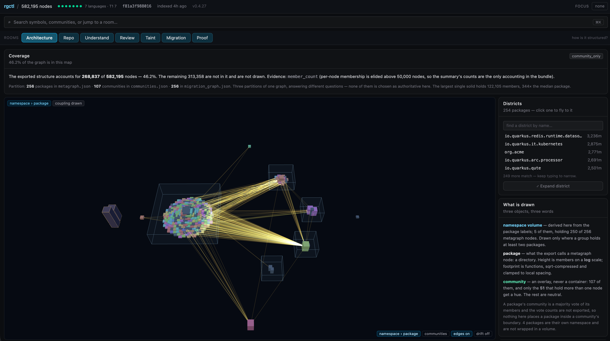
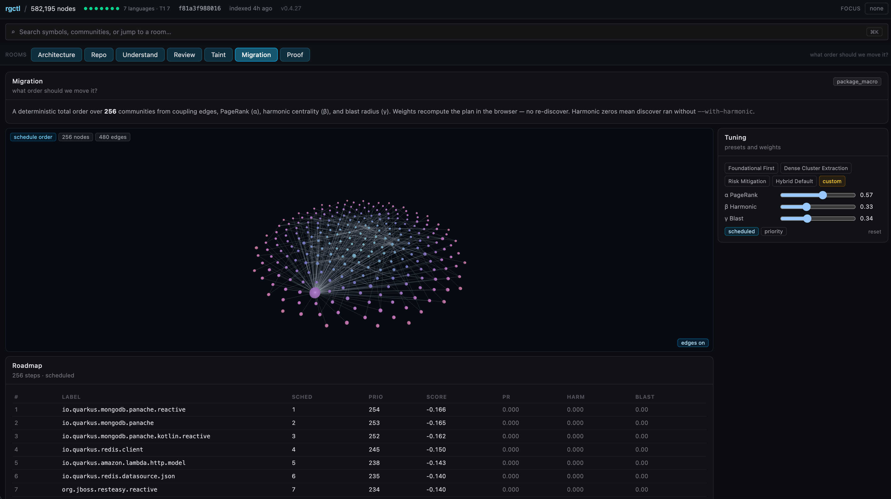
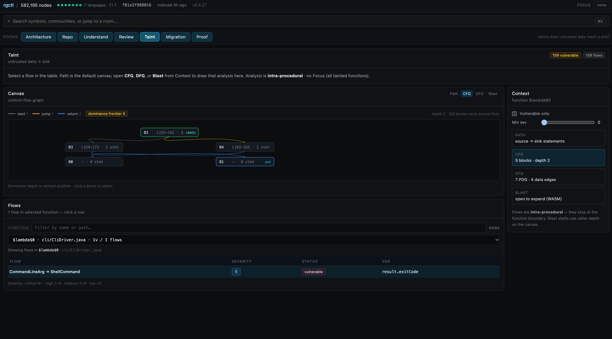
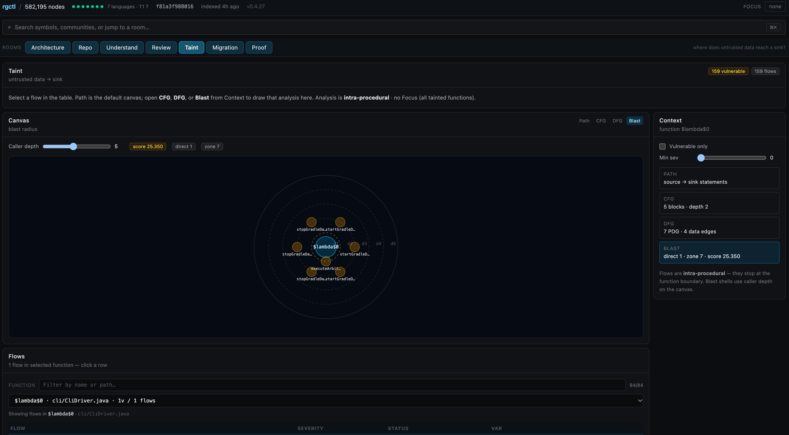

# rgctl v0.4.29

Reachability now answers two questions agents keep asking: which symbols nothing calls, and which advisories a real call path can hit. Overloaded methods keep their own identity across discover, update, and the dashboard. Come talk about what you find — [Discord](https://discord.gg/FVMcqbe4U) is open, and you do not need a pull request to join.

```bash
rgctl --version   # 0.4.29

# Dead code from the call graph you already indexed
rgctl discover .
rgctl -f json dead-code --confidence high --limit 20

# Whole-repo OSV reachability, then a SARIF file for GitHub code scanning
rgctl -f json vuln scan --offline
rgctl -f sarif vuln scan --offline --strict-reachability -o .rgctl/findings.sarif

# Pick one overload, then ask who it reaches
rgctl -f json blast-radius 'CartService::clearCart' --line 88 --depth 2
```

## Highlights

### Dead-code detection (`rgctl dead-code`) ([#159](https://github.com/rgctl/rgctl/pull/159))

`dead-code` walks the indexed call graph from entry points and reports symbols nothing reaches. Run `discover` first. Text output groups findings by confidence. `-f json` returns `schema_version`, a `summary` (`total_symbols`, `reachable_symbols`, `dead_symbols`, `entry_points`), and `findings[]` with `symbol_name`, `qualified_name`, `file_path`, `start_line`, `end_line`, `node_type`, `kind`, `confidence`, `reason`, and `node_id`.

Confidence is `high`, `medium`, or `low`. `--confidence` takes one level or a comma-separated list. An unknown level such as `hig` fails immediately instead of returning an empty report. Public symbols that nothing references are reported as **low** confidence. They are not silently treated as roots, so an unused public method still shows up.

```bash
rgctl discover .

# High-confidence findings only
rgctl -f json dead-code --confidence high --limit 50

# High and medium together
rgctl -f json dead-code --confidence high,medium

# Treat these names, qualified names, or file globs as extra roots
rgctl dead-code \
  --entry-point 'com.example.App::main' \
  --entry-point 'src/main/**'

# Drop generated trees (path or name substring, or a glob)
rgctl dead-code --exclude 'target/'

# Test symbols are skipped unless you ask for them
rgctl dead-code --include-tests
```

Entry-point classes keep their methods. `Contains` edges are part of the walk, so seeding a type does not mark every method on that type dead. An import is an unused import only when it has an outbound `Uses`, `References`, or `Calls` edge to something inside the repo. External and stdlib imports with no resolved internal edge are left alone.

### Vulnerability reachability, batch scan, and SARIF ([#209](https://github.com/rgctl/rgctl/pull/209))

`vuln scan` checks the repo’s dependencies against OSV and reports whether a call path can reach a vulnerable sink. A normal `discover` is enough: scan and analyze build CFG and PDG for the functions they touch, lazily, instead of requiring `discover --with-cfg` up front. Use `discover --full` when you also want taint, Universe, and the semantic index in one pass.

```bash
# Fetch the OSV feed for manifests in this repo, then scan
rgctl vuln fetch
rgctl -f json vuln scan

# No network: use the .rgctl/osv/ cache, and stitch calls through JARs
rgctl -f json vuln scan --offline --include-jars lib --with-dep-stubs

# Start from a scanner you already run, plus a CycloneDX or SPDX SBOM
rgctl -f json vuln scan --from-report trivy.json --sbom bom.cdx.json

# One advisory, local JSON, no fetch
rgctl -f json vuln analyze --osv GHSA-example.json

# Fail closed in CI: inconclusive reachable sinks count as exploitable
rgctl -f json vuln scan --offline --strict-reachability

# SARIF 2.1.0 with code flows, for GitHub code scanning
rgctl -f sarif vuln scan --offline -o .rgctl/findings.sarif
```

`-f json` on `vuln analyze` and each `vuln scan` result includes the dependency verdict, exploitability, OpenVEX v0.2.0 statements (canonical `pkg:` PURLs), and sink taint. The verdict is one of `not_affected`, `not_exploitable`, `under_investigation`, or `exploitable`. `--strict-reachability` treats an inconclusive reachable sink as `exploitable`. `-f sarif` emits SARIF 2.1.0 with code flows. `--with-dep-stubs` writes `.rgctl/dep_stubs.bin` so a call that only exists inside a wrapper JAR or `node_modules` can still connect first-party code to a sink. Drop YAML under `.rgctl/vuln-rules.d/` when a CVE only applies if a trigger is present. `--offline`, `--osv`, and `--from-report` do not call the network.

`vuln fetch` posts dependency coordinates to the OSV API (`RGCTL_OSV_API_URL` or `--osv-api-url`) and stores one JSON file per advisory in `.rgctl/osv/`. Scan reads the lockfiles and manifests already in the tree, including Cargo, Go, Maven, Gradle, npm, pnpm, Yarn, uv, Poetry, pip, Bundler, Composer, Pub, Mix, and NuGet. The reachability check covers the 20 taint-enabled Tier 1 languages. Standalone `rgctl taint` and `security taint` still need `discover --with-cfg`.

The agent pack follows the same path. `rgctl install --skill` updates `/rgctl:vuln` so an agent routes “are we affected by this CVE?” to `vuln fetch`, `vuln scan`, and `vuln analyze` instead of grepping lockfiles.

```bash
rgctl install --skill --tools cursor,claude,codex,antigravity,agents
```

`security vuln …` and `security deps check` remain aliases of the top-level commands.

### Overload identity across Tier 1 languages ([#196](https://github.com/rgctl/rgctl/pull/196), [#206](https://github.com/rgctl/rgctl/pull/206))

Two methods with the same name no longer collapse into one graph node ([#196](https://github.com/rgctl/rgctl/pull/196), closing [#183](https://github.com/rgctl/rgctl/issues/183)). Each language records a canonical callable discriminator (parameters, not the body and not a line number). That discriminator is part of the stable id when it is present, and the same id is what `discover`, `update`, CFG lookup, and field spans use. An empty discriminator keeps the previous id, so symbols that were already unique do not move.

Inherited dispatch and extraction-time overrides match that identity. Ambiguous CFG selection and overload-cache remaps are rejected instead of attaching one body to the wrong method. A field and a method can share a name. Node kind keeps them apart. The discriminator is only for callable declarations.

Java lambdas keep one identity when symbol extraction and relation extraction walk the same file ([#206](https://github.com/rgctl/rgctl/pull/206), fixing [#197](https://github.com/rgctl/rgctl/issues/197)). A lambda body is no longer left with a call aimed at a different synthetic name.

```bash
rgctl discover .

# Both overloads come back as separate entities, each with signature and byte spans
rgctl -f json find --type function clearCart

# Line, class, or file picks one of them for impact
rgctl -f json blast-radius 'CartService::clearCart' --class CartService --line 88 --depth 2
rgctl -f json callers clearCart --class CartService --depth 1

# CFG for that body, then an incremental update that stays on the same callable
rgctl inspect 'CartService::clearCart' cfg
rgctl update

# Field nodes and identifier spans, without building CFG or PDG
rgctl discover . --with-fields
```

`--with-fields` materializes supported fields with owner, type, and declaration spans. `--with-cfg` and `--full` still include fields. Default discover leaves that extra field pass off. Some languages already emit property symbols without the flag.

If you stored node ids from an older snapshot, re-run `discover`. Overloads that gained a discriminator have new ids. Unique symbols keep theirs. Facts-cache format 11 and extraction semantics 14 drop a stale incremental cache, including a previous `discover --files` run, and rebuild those files.

### Lossless spans on every Tier 1 language ([#201](https://github.com/rgctl/rgctl/pull/201))

`discover --lossless` and `writeback` now round-trip all 24 Tier 1 languages: C, C++, C#, Go, Groovy, Java, JavaScript, Kotlin, Markdown, PHP, Puppet, ERB, Python, Ruby, Rust, TypeScript, Swift, Scala, Dart, Elixir, Lua, Bash, SQL, and HCL ([#201](https://github.com/rgctl/rgctl/pull/201), [#199](https://github.com/rgctl/rgctl/issues/199)). Declaration spans, identifier offsets, and call-site spans are extracted for each of them. The 42 `tags.scm` languages and COBOL, PL/I, and JCL record symbol and call-site spans too. Config keys in YAML, JSON, TOML, properties, and XML keep their source line spans.

```bash
rgctl discover . --lossless
rgctl writeback verify -f json
rgctl writeback export --output ./reconstructed -f json
```

Queries can use that identity. `find -f json` includes `signature` next to the qualified name and byte spans. `blast-radius --line` keeps the declaration on that line when several symbols share a name. `callers` and `blast-radius` apply `--file` before treating same-named symbols as a collision, and they recognize constructors in C#, C++, Java, Kotlin, Scala, and Dart. Calls inside the second and later overloads stay on the declaration that contains them. `inspect cfg` prefers a concrete method body over a bodiless interface, trait, or protocol with the same short name.

Swift, Dart, Scala, and Elixir keep `extends` apart from protocols, mixins, traits, and behaviours. Scala, Kotlin, Ruby, Swift, Dart, and Bash lower `match`, `try`, `switch`, `rescue`, and shell statements into real CFG edges instead of skipping them. Def-use extraction covers C#, Kotlin, Puppet, Dart, Lua, and Bash. Backward slices walk reverse PDG edges across formal parameters. `slice`, `inspect`, and `cpg` read those edges.

Cold `discover` reuses the file list from the first walk, routes extensions without allocating per file, and compiles `tags.scm` queries on first use.

### Universe export ([#203](https://github.com/rgctl/rgctl/pull/203))

`discover --with-universe` and `--export-migration-hints` read the snapshot from the mmap instead of hydrating a full in-memory graph ([#203](https://github.com/rgctl/rgctl/pull/203), closing [#181](https://github.com/rgctl/rgctl/issues/181) and [#202](https://github.com/rgctl/rgctl/issues/202)). Repositories with more than 5,000 functions pack slice detail into `slice.record_index.bin` and `slice.record_data.bin` instead of one JSON file per function. The dashboard manifest advertises that archive, and the browser build opens columnar snapshots v2 and v3, including the callable discriminator. Function metadata is resolved from the graph when the analysis key is opaque, so the universe view no longer depends on splitting those keys.

```bash
rgctl discover . --with-universe
rgctl serve --open
```

The Architecture room draws namespace volumes, packages, and the coupling between them. On this index, 268,837 of 582,195 nodes are in the map. Communities are an overlay on that same graph, not a second partition.



The Migration room orders those communities from coupling, PageRank, harmonic centrality, and blast radius. The weights recompute in the browser. Harmonic and blast columns stay at zero when discover ran without those passes.



The Taint room is the same dashboard after a discover that recorded flows (`--with-taint` or `--full`). Pick a flow and the canvas draws its CFG, the data-flow edges, or the caller blast radius. The flow below is intra-procedural: a command-line argument reaches a shell call inside a Java lambda, and the blast view stops at the function boundary.





### Betweenness samples code that actually calls ([#201](https://github.com/rgctl/rgctl/pull/201))

`metrics --betweenness` draws its pivots from vertices with outgoing edges and weights them with Horvitz–Thompson sampling (`splitmix64` mixes the PRNG so power-of-two sample sizes do not stick on the low bits) ([#201](https://github.com/rgctl/rgctl/pull/201), [#187](https://github.com/rgctl/rgctl/issues/187)). Files, imports, and other sinks with no outgoing calls no longer eat the sample. On a polyglot graph those nodes are most of the vertices, so bridge functions were easy to miss. Node ids used to build the graph are sorted, so a repeated `metrics` run on the same snapshot assigns the same dense indices.

```bash
rgctl discover .
rgctl -f json metrics --betweenness
rgctl -f json metrics --pagerank
rgctl -f json metrics --communities
```

### Release binaries ([#217](https://github.com/rgctl/rgctl/issues/217))

v0.4.28 was tagged, and the release build failed before GitHub published it. These notes are the first published set since v0.4.27.

Musl archives use rustls for `vuln fetch`, so the cross build no longer needs a musl OpenSSL. Windows archives include the ONNX Runtime DLLs next to `rgctl.exe`. Musl archives still omit `semantic index --embedder code-daemon`. The default vocab embedder is in every archive.

```bash
# Alpine / musl
rgctl --version
rgctl vuln fetch

# Windows: rgctl.exe, onnxruntime.dll, and DirectML.dll ship in the same zip
rgctl semantic index --embedder code-daemon
```

## Breaking changes

| Changed | Migration |
|---------|-----------|
| Overloaded callables with a discriminator get a new stable node id. Symbols with no discriminator keep the previous id. | Re-run `discover` (and `discover --lossless` if you use write-back). Do not reuse node ids from a snapshot taken before 0.4.29 for those overloads. |
| Facts-cache format 11 and extraction semantics 14 replace older incremental caches. | The next `discover` or `update` rebuilds affected files. Delete `.rgctl/` when you want a clean snapshot. |
| Universe bundles for repos with more than 5,000 functions no longer write one `slice/<uuid>.json` per function. | Read `slice.record_index.bin` and `slice.record_data.bin`. The manifest sets `capabilities.slice_detail_archive`. |
| `dead-code` no longer treats every public symbol as an entry point. Unreferenced public API is reported as low confidence. | Pass `--entry-point` for mains, framework callbacks, and other roots you want kept. Filter with `--confidence high` when you only want the strict set. |

## Issues / PRs

| Ref | Title |
|-----|-------|
| [#159](https://github.com/rgctl/rgctl/pull/159) | Dead-code detection via graph reachability |
| [#196](https://github.com/rgctl/rgctl/pull/196) | Tier 1 callable identity and inherited overrides ([#183](https://github.com/rgctl/rgctl/issues/183)) |
| [#201](https://github.com/rgctl/rgctl/pull/201) | 24-language lossless spans, query disambiguation, and active-pivot betweenness ([#199](https://github.com/rgctl/rgctl/issues/199), [#187](https://github.com/rgctl/rgctl/issues/187)) |
| [#203](https://github.com/rgctl/rgctl/pull/203) | `--with-universe` export reads the mmap snapshot ([#181](https://github.com/rgctl/rgctl/issues/181), [#202](https://github.com/rgctl/rgctl/issues/202)) |
| [#206](https://github.com/rgctl/rgctl/pull/206) | Java lambda identities stay aligned across extraction passes ([#197](https://github.com/rgctl/rgctl/issues/197)) |
| [#209](https://github.com/rgctl/rgctl/pull/209) | Tier 1 vulnerability reachability, OSV fetch/scan, OpenVEX, and SARIF |
| [#212](https://github.com/rgctl/rgctl/pull/212) | Attribute calls by full declaration source spans ([#211](https://github.com/rgctl/rgctl/issues/211)) |
| [#217](https://github.com/rgctl/rgctl/issues/217) | Musl OpenSSL and Windows ONNX Runtime release builds |

## Thanks

This release has a first-time contributor. **[@shawn-hurley](https://github.com/shawn-hurley)** (Shawn Hurley) landed two fixes that keep the graph honest. [#196](https://github.com/rgctl/rgctl/pull/196) preserves callable identity and field spans across the Tier 1 languages, and [#206](https://github.com/rgctl/rgctl/pull/206) stops Java lambda extraction from pointing a call at the wrong body. Thank you for a careful first contribution. It is the kind of correctness work that makes every later query trustworthy.

**[@savitharaghunathan](https://github.com/savitharaghunathan)** (Savitha Raghunathan) added `rgctl dead-code` in [#159](https://github.com/rgctl/rgctl/pull/159) and stayed with it: confidence levels that fail loud, entry-point and import rules, the hot-path pass, and tests that lock the JSON contract. Returning contributors who pick up a feature and finish it are how this project gets tools people can run.

Questions, rough ideas, and “does this look right?” are welcome on [Discord](https://discord.gg/FVMcqbe4U). You do not need a patch, a language proposal, or a complete question. Say hello, show a repo, or ask which command to try first. The same invite is on the [community page](https://rgctl.io/community/). Issues and pull requests remain open on [GitHub](https://github.com/rgctl/rgctl/issues), and [CONTRIBUTING.md](../../CONTRIBUTING.md) is there when you want to go further.

**Full changelog:** https://github.com/rgctl/rgctl/compare/v0.4.27...v0.4.29
